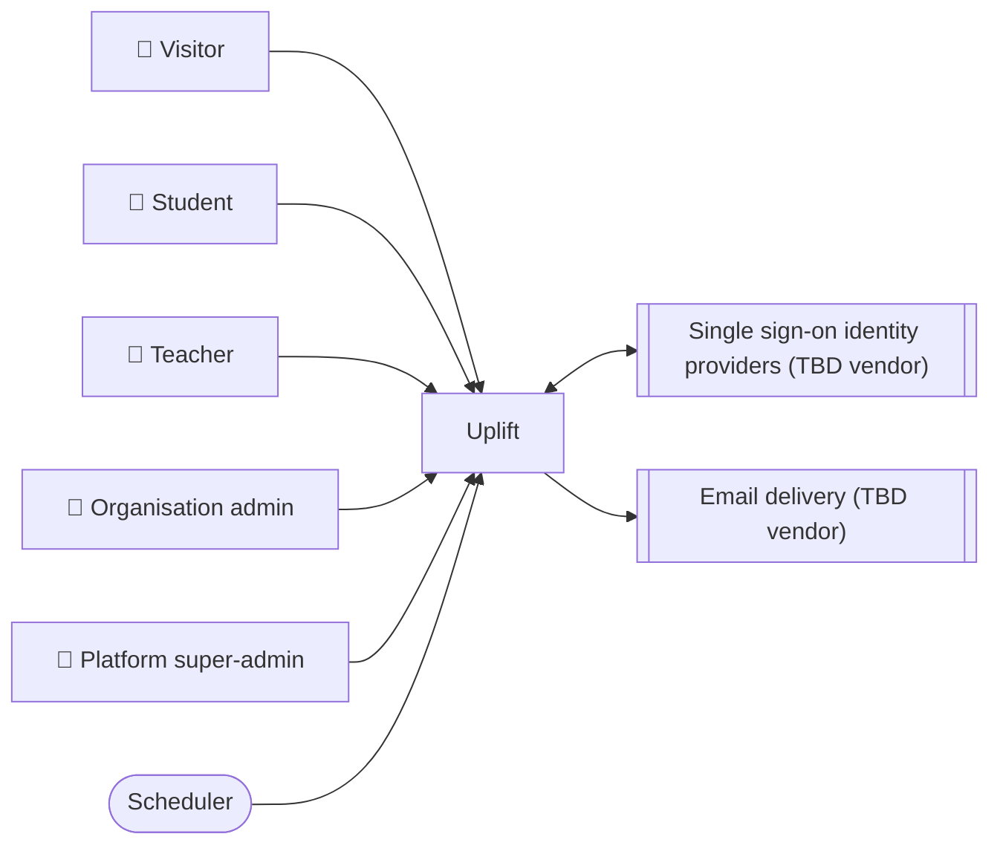

<!-- GENERATED from design/ — do not edit. Rebuild with tools/design/build.py -->
# Uplift — overview

_Generated document · design v2.0.0 · source 6e9830763376_

Multi-tenant SaaS educational platform where organisations (universities, schools, tutoring centres, companies) run course spaces with interactive activities: quizzes, polls, assignment-topic selection and proposal, and presentation/exam slot booking. Its flagship is a real-time live quiz with gamification, backed by analytics for teachers and organisations.

**Status:** baselined at v1.0.0 (2026-10-19)

## Documents

- [Scope](scope.md)
- [Actors and use cases](use-cases.md)
- [External systems](external-systems.md)
- [Data](data.md)
- [Security](security.md)
- [Architecture](architecture.md)
- [Integrations](integrations.md)
- [Operations](operations.md)
- [Phases](phases.md)
- [All decisions](decisions.md)

## Context

## Open decisions

_none_

## Deferred

- OPS-001 — Production hosting → PHASE-9
- OPS-003 — Operational targets (RPO, RTO, availability, backups) → PHASE-9
- SCOPE-018 — Gamification rules → PHASE-6
- SEC-003 — GDPR and minors' data hardening → PHASE-9
- EXT-001 — Single sign-on identity providers → after the first production release (no phase yet; future amendment)
- EXT-002 — Email delivery → PHASE-9
