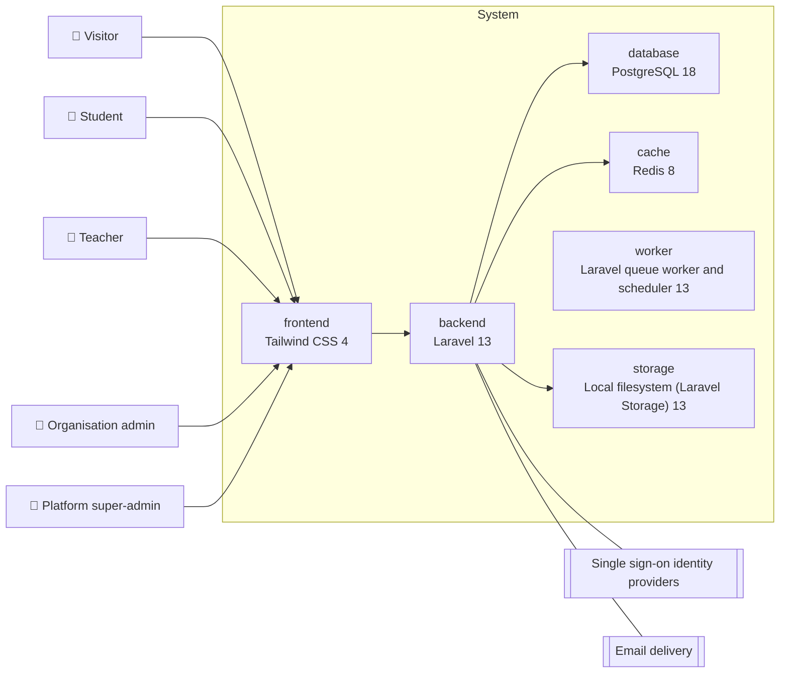
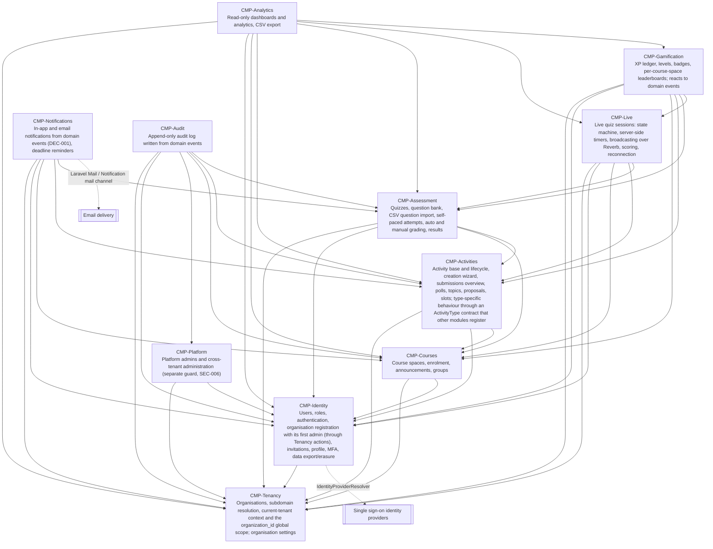

<!-- GENERATED from design/ — do not edit. Rebuild with tools/design/build.py -->
# Architecture and stack

_Generated document · design v2.1.0 · source dcadfdfa5719_

**Style:** modular-monolith · **database:** postgresql

## Containers

## Stack

| role | technology | version | why |
|---|---|---|---|
| backend | PHP | 8.3 | Laravel 13 minimum; matches the engineer's machine (ARCH-005) |
| backend | Laravel | 13 | ARCH-001 |
| frontend | Inertia.js | 3 | ARCH-001 |
| frontend | Vue | 3.5 | ARCH-001 |
| frontend | TypeScript | 5 | Official Vue starter kit; safer complex UI (ARCH-005) |
| frontend | Tailwind CSS | 4 | Token-driven design system with per-organisation accent and dark mode (design brief) |
| database | PostgreSQL | 18 | ARCH-001; CTI and JSONB (DATA-001) |
| cache | Redis | 8 | ARCH-001: cache, queue and broadcasting |
| other | Laravel Reverb | 1 | ARCH-001: real-time live quiz, self-hosted and free |
| worker | Laravel queue worker and scheduler | 13 | ARCH-001: async jobs, emails (EXT-002), reminders (UC-038) |
| storage | Local filesystem (Laravel Storage) | 13 | Logos and CSV uploads; S3-compatible disk later without code changes |

## Components

| id | responsibility | owns | implements | may depend on |
|---|---|---|---|---|
| CMP-Tenancy | Organisations, subdomain resolution, current-tenant context and the organization_id global scope; organisation settings | ENT-Organization | UC-002, UC-033 |  |
| CMP-Identity | Users, roles, authentication, organisation registration with its first admin (through Tenancy actions), invitations, profile, MFA, data export/erasure | ENT-User, ENT-Invitation | UC-001, UC-003, UC-004, UC-005, UC-006, UC-032, UC-039 | CMP-Tenancy |
| CMP-Platform | Platform admins and cross-tenant administration (separate guard, SEC-006) | ENT-PlatformAdmin | UC-035, UC-036 | CMP-Tenancy, CMP-Identity |
| CMP-Courses | Course spaces, enrolment, announcements, groups | ENT-CourseSpace, ENT-Enrolment, ENT-Announcement, ENT-Group, ENT-GroupMembership | UC-008, UC-011, UC-019, UC-021 | CMP-Tenancy, CMP-Identity |
| CMP-Activities | Activity base and lifecycle, creation wizard, submissions overview, polls, topics, proposals, slots; type-specific behaviour through an ActivityType contract that other modules register | ENT-Activity, ENT-Poll, ENT-PollOption, ENT-PollParticipation, ENT-PollVote, ENT-TopicActivity, ENT-Topic, ENT-TopicChoice, ENT-TopicProposal, ENT-SlotActivity, ENT-Slot, ENT-Booking | UC-013, UC-014, UC-015, UC-016, UC-022, UC-027, UC-028 | CMP-Tenancy, CMP-Identity, CMP-Courses |
| CMP-Assessment | Quizzes, question bank, CSV question import, self-paced attempts, auto and manual grading, results | ENT-Quiz, ENT-Question, ENT-ChoiceOption, ENT-MatchingPair, ENT-QuizQuestion, ENT-QuizAttempt, ENT-Answer, ENT-AnswerSelection, ENT-AnswerMatch | UC-012, UC-017, UC-023, UC-026, UC-030 | CMP-Tenancy, CMP-Identity, CMP-Courses, CMP-Activities |
| CMP-Live | Live quiz sessions: state machine, server-side timers, broadcasting over Reverb, scoring, reconnection | ENT-LiveSession, ENT-LiveParticipant, ENT-LiveAnswer | UC-024, UC-025 | CMP-Tenancy, CMP-Identity, CMP-Courses, CMP-Activities, CMP-Assessment |
| CMP-Gamification | XP ledger, levels, badges, per-course-space leaderboards; reacts to domain events | ENT-XpEvent, ENT-Badge, ENT-UserBadge | UC-018, UC-037 | CMP-Tenancy, CMP-Identity, CMP-Courses, CMP-Activities, CMP-Assessment, CMP-Live |
| CMP-Analytics | Read-only dashboards and analytics, CSV export |  | UC-010, UC-020, UC-029, UC-031, UC-034 | CMP-Tenancy, CMP-Identity, CMP-Courses, CMP-Activities, CMP-Assessment, CMP-Live, CMP-Gamification |
| CMP-Notifications | In-app and email notifications from domain events (DEC-001), deadline reminders | ENT-Notification, ENT-NotificationPreference | UC-007, UC-038 | CMP-Tenancy, CMP-Identity, CMP-Courses, CMP-Activities, CMP-Assessment |
| CMP-Audit | Append-only audit log written from domain events | ENT-AuditEntry |  | CMP-Tenancy, CMP-Identity, CMP-Platform, CMP-Courses, CMP-Activities, CMP-Assessment |

## Approved dependencies

| name | version | scope | provider-specific |
|---|---|---|---|
| laravel/framework | ^13.0 | runtime | False |
| inertiajs/inertia-laravel | ^3.0 | runtime | False |
| laravel/fortify | ^1.0 | runtime | False |
| laravel/reverb | ^1.0 | runtime | False |
| laravel/sail | ^1.0 | dev | False |
| pestphp/pest | ^4.0 | dev | False |
| pestphp/pest-plugin-laravel | ^4.0 | dev | False |
| pestphp/pest-plugin-browser | ^4.0 | dev | False |
| larastan/larastan | ^3.0 | dev | False |
| laravel/pint | ^1.0 | dev | False |
| deptrac/deptrac | ^2.0 | dev | False |
| vue | ^3.5 | runtime | False |
| @inertiajs/vue3 | ^3.0 | runtime | False |
| typescript | ^5.0 | dev | False |
| tailwindcss | ^4.0 | dev | False |
| laravel-echo | ^2.0 | runtime | False |
| pusher-js | ^8.0 | runtime | False |
| laravel-vue-i18n | ^2.0 | runtime | False |
| chart.js | ^4.0 | runtime | False |
| vue-chartjs | ^5.0 | runtime | False |
| vue-draggable-plus | ^0.6 | runtime | False |
| eslint | ^9.0 | dev | False |
| prettier | ^3.0 | dev | False |
| vitest | ^4.0 | dev | False |
| laravel/tinker | ^3.0 | runtime | False |
| laravel/wayfinder | ^0.1 | runtime | False |
| reka-ui | ^2.0 | runtime | False |
| @lucide/vue | ^1.0 | runtime | False |
| @vueuse/core | ^12.0 | runtime | False |
| class-variance-authority | ^0.7 | runtime | False |
| clsx | ^2.0 | runtime | False |
| tailwind-merge | ^3.0 | runtime | False |
| tw-animate-css | ^1.0 | runtime | False |
| vue-sonner | ^2.0 | runtime | False |
| vue-input-otp | ^0.3 | runtime | False |
| laravel-vite-plugin | ^2.0 | dev | False |
| @inertiajs/vite | ^3.0 | dev | False |

## Conventions

- Modules live in app/Modules/<Name>/ with Actions, Models, Policies, Events, Listeners, Http; each registers its own routes, broadcast channels and listeners in its service provider
- Vue pages live in resources/js/Pages/<Module>/; shared UI components come from shadcn-vue
- Controllers only validate, authorise and call one Action; business logic lives in Actions/Services (ARCH-003)
- Cross-module side effects go through domain events and listeners, never direct calls (ARCH-003)
- UI strings live in lang/el and lang/en and reach Vue through laravel-vue-i18n (SCOPE-020)
- Tests: Pest unit and feature tests; Pest browser tests for core flows including a multi-player live quiz; every ownership and tenant-isolation rule has a dedicated test
- Static checks: Pint, Larastan level 6, deptrac rules generated from may_depend_on, ESLint, Prettier, Vitest
- Development runs on Laravel Sail (PostgreSQL, Redis, Mailpit, Reverb)
- The few JSON endpoints (wizard autosave, subdomain check) return errors as RFC 9457 problem details
- Logs are structured JSON on stdout and contain no personal data
- Migrations are timestamped and live in their module
- All runtime packages are installed in phase 1; during phase 1 dev-only packages (build, test, lint, types) may be added without a decision and are listed in the P1-T1 handoff; after phase 1 any new package, runtime or dev, needs a change request (ARCH-007)

## Hotspots (shared files)

- `composer.json`
- `package.json`
- `bootstrap/providers.php`
- `routes/channels.php`

## Decisions

| id | title | status | decision |
|---|---|---|---|
| ARCH-001 | Technology stack | decided | Laravel backend, Inertia.js + Vue 3 frontend, PostgreSQL database, Laravel Reverb + Echo for real-time, Laravel Queues/Jobs/Scheduler for async work, Redis for cache, queue and broadcasting |
| ARCH-002 | Multi-tenancy model | decided | Single database, row-level tenancy: every tenant-owned table has organization_id, enforced by an Eloquent global scope; each organisation is reached on its own subdomain |
| ARCH-003 | Code structure | decided | Thin controllers delegate to Actions/Services; side effects are driven by domain events handled by listeners |
| ARCH-004 | Modular monolith | decided (inferred) | One deployable Laravel application split into 11 modules (see components) with dependencies enforced by deptrac; activity types plug into Activities through an ActivityType contract |
| ARCH-005 | Versions and frontend language | decided | PHP 8.3, Laravel 13, Inertia 3 (or the version the starter kit ships), Vue 3.5 with TypeScript, Tailwind 4, PostgreSQL 18, Redis 8, Reverb 1. Exact versions are pinned by lockfiles in phase 1 |
| ARCH-006 | Real-time and integration policies | decided (default) | Live answers go over HTTP, never websocket client events; the server alone decides time; Reverb outage falls back to HTTP polling every 2 seconds for students and teacher; integration logs carry ids only; email is queued with 5 retries |
| ARCH-007 | Starter kit dependencies and dev tooling | decided | Keep the official Vue starter kit and shadcn-vue and approve their runtime packages (tinker, wayfinder, reka-ui, lucide, vueuse, class-variance-authority, clsx, tailwind-merge, tw-animate-css, vue-sonner, vue-input-otp); remove the kit's passkeys and chisel; use vitest ^4 to match the kit's vite 8; lint and format with ESLint and Prettier instead of the kit's vite-plus; during phase 1 dev-only packages may be added without a decision |
| ARCH-008 | Organisation authorisation through a Tenancy contract | decided (inferred) | CMP-Tenancy defines App\Modules\Tenancy\Contracts\OrganizationMember (organizationId(): string, administersOrganization(): bool) and authorises organisation actions in its own OrganizationPolicy against that contract only; Identity's User implements it (administersOrganization() is role === org_admin) |
