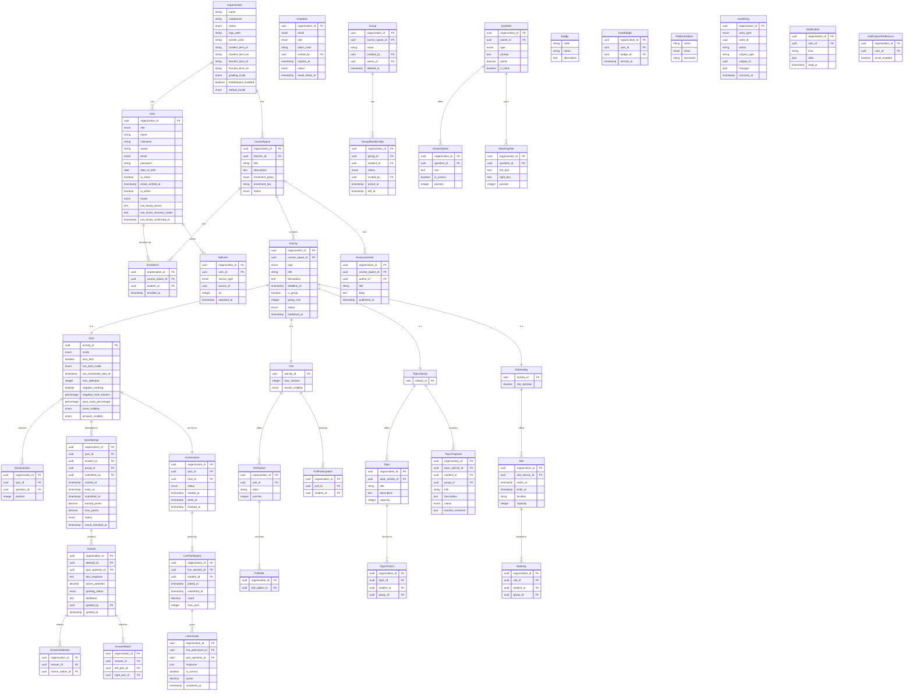
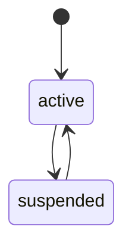
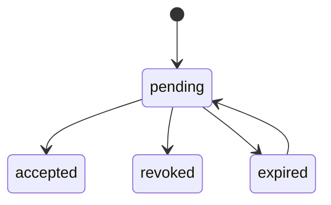
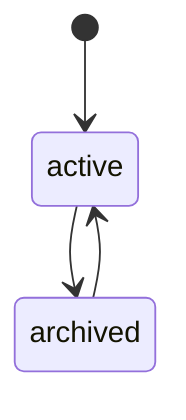
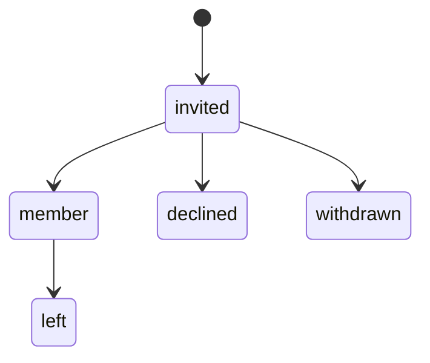
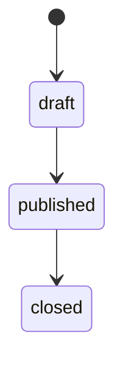
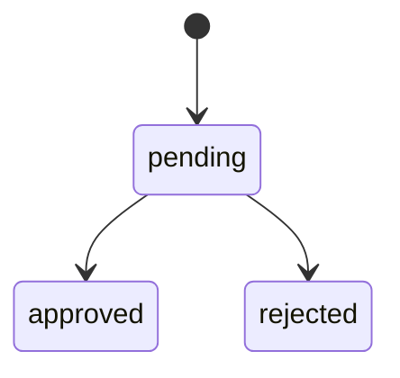
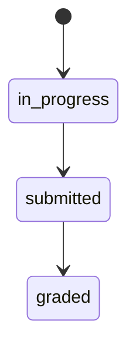
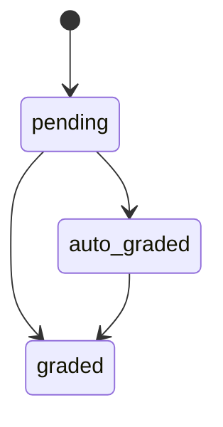
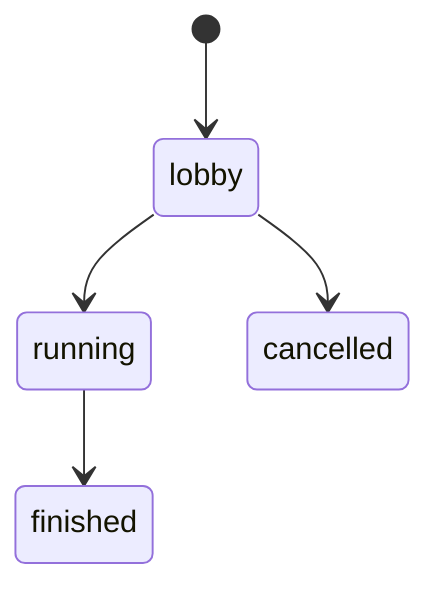

<!-- GENERATED from design/ — do not edit. Rebuild with tools/design/build.py -->
# Data

_Generated document · design v3.5.0 · source 174b6708ecea_

## Entity–relationship diagram

#### ENT-Organization — A tenant: school, university, tutoring centre or company

Owned by CMP-Tenancy · retention: — · audit: no

| attribute | type | storage | notes |
|---|---|---|---|
| name | string | string(255) | required |
| subdomain | string | string(255) | required, unique |
| status | enum | string | required |
| logo_path | string | string(255) |  |
| accent_color | string | string(255) |  |
| student_term_el | string | string(255) | required |
| student_term_en | string | string(255) | required |
| teacher_term_el | string | string(255) | required |
| teacher_term_en | string | string(255) | required |
| grading_scale | enum | string | required |
| leaderboard_enabled | boolean | boolean | required |
| default_locale | enum | string | required |

Relations: one-to-many → ENT-User (on delete restrict); one-to-many → ENT-CourseSpace (on delete restrict)

States: initial `active`; allowed transitions: `active -> suspended`, `suspended -> active`

#### ENT-User — A person in exactly one organisation with exactly one role (SEC-004)

Owned by CMP-Identity · retention: While the account exists; erasure and anonymisation periods are set by SEC-003 · audit: no

| attribute | type | storage | notes |
|---|---|---|---|
| organization_id | uuid | uuid | → ENT-Organization, required |
| role | enum | string | required |
| name | string | string(255) | required, personal |
| nickname | string | string(255) | required, personal |
| avatar | string | string(255) |  |
| email | email | string(254) | required, unique, personal |
| password | string | string(255) | sensitive |
| date_of_birth | date | date | personal |
| is_minor | boolean | boolean | personal |
| email_verified_at | timestamp | timestamptz |  |
| is_active | boolean | boolean | required |
| locale | enum | string |  |
| two_factor_secret | text | text | sensitive |
| two_factor_recovery_codes | text | text | sensitive |
| two_factor_confirmed_at | timestamp | timestamptz |  |

Relations: one-to-many → ENT-Enrolment (on delete cascade); one-to-many → ENT-XpEvent (on delete cascade)

#### ENT-Invitation — Invitation of an email address to join an organisation with a role

Owned by CMP-Identity · retention: Deleted 30 days after it stops being pending · audit: no

| attribute | type | storage | notes |
|---|---|---|---|
| organization_id | uuid | uuid | → ENT-Organization, required |
| email | email | string(254) | required, personal |
| role | enum | string | required |
| token_hash | string | string(255) | required, sensitive |
| invited_by | uuid | uuid | → ENT-User, required |
| expires_at | timestamp | timestamptz | required |
| status | enum | string | required |
| email_failed_at | timestamp | timestamptz |  |

States: initial `pending`; allowed transitions: `pending -> accepted`, `pending -> revoked`, `pending -> expired`, `expired -> pending`

#### ENT-CourseSpace — A course space owned by exactly one teacher (SCOPE-007)

Owned by CMP-Courses · retention: — · audit: no

| attribute | type | storage | notes |
|---|---|---|---|
| organization_id | uuid | uuid | → ENT-Organization, required |
| teacher_id | uuid | uuid | → ENT-User, required |
| title | string | string(255) | required |
| description | text | text |  |
| enrolment_policy | enum | string | required |
| enrolment_key | string | string(255) |  |
| status | enum | string | required |

Relations: one-to-many → ENT-Enrolment (on delete cascade); one-to-many → ENT-Activity (on delete restrict); one-to-many → ENT-Announcement (on delete cascade)

States: initial `active`; allowed transitions: `active -> archived`, `archived -> active`

#### ENT-Enrolment — A student's enrolment in a course space (unique per pair)

Owned by CMP-Courses · retention: Deleted when the course space is archived (DATA-012); follows the student's erasure (SEC-003) · audit: no

| attribute | type | storage | notes |
|---|---|---|---|
| organization_id | uuid | uuid | → ENT-Organization, required |
| course_space_id | uuid | uuid | → ENT-CourseSpace, required |
| student_id | uuid | uuid | → ENT-User, required |
| enrolled_at | timestamp | timestamptz | required |

#### ENT-Announcement — Announcement posted in a course space

Owned by CMP-Courses · retention: — · audit: no

| attribute | type | storage | notes |
|---|---|---|---|
| organization_id | uuid | uuid | → ENT-Organization, required |
| course_space_id | uuid | uuid | → ENT-CourseSpace, required |
| author_id | uuid | uuid | → ENT-User, required |
| title | string | string(255) | required |
| body | text | text | required |
| published_at | timestamp | timestamptz |  |

#### ENT-Group — A student group in a course space, used for group activities

Owned by CMP-Courses · retention: — · audit: no

| attribute | type | storage | notes |
|---|---|---|---|
| organization_id | uuid | uuid | → ENT-Organization, required |
| course_space_id | uuid | uuid | → ENT-CourseSpace, required |
| name | string | string(255) | required |
| created_by | uuid | uuid | → ENT-User, required |
| owner_id | uuid | uuid | → ENT-User, required |
| deleted_at | timestamp | timestamptz |  |

Relations: one-to-many → ENT-GroupMembership (on delete cascade)

#### ENT-GroupMembership — Membership or pending invitation of a student in a group; a new row per invitation, old rows kept as history (SCOPE-025)

Owned by CMP-Courses · retention: Kept with the group; follows the student's erasure (SEC-003) · audit: no

| attribute | type | storage | notes |
|---|---|---|---|
| organization_id | uuid | uuid | → ENT-Organization, required |
| group_id | uuid | uuid | → ENT-Group, required |
| student_id | uuid | uuid | → ENT-User, required |
| status | enum | string | required |
| invited_by | uuid | uuid | → ENT-User |
| joined_at | timestamp | timestamptz |  |
| left_at | timestamp | timestamptz |  |

States: initial `invited`; allowed transitions: `invited -> member`, `invited -> declined`, `invited -> withdrawn`, `member -> left`

#### ENT-Activity — Base table of the five activity types; one subtype row per activity

Owned by CMP-Activities · retention: — · audit: no

| attribute | type | storage | notes |
|---|---|---|---|
| organization_id | uuid | uuid | → ENT-Organization, required |
| course_space_id | uuid | uuid | → ENT-CourseSpace, required |
| type | enum | string | required |
| title | string | string(255) | required |
| description | text | text |  |
| deadline_at | timestamp | timestamptz |  |
| is_group | boolean | boolean | required |
| group_size | integer | integer |  |
| status | enum | string | required |
| published_at | timestamp | timestamptz |  |

Relations: one-to-one → ENT-Quiz (on delete cascade); one-to-one → ENT-Poll (on delete cascade); one-to-one → ENT-TopicActivity (on delete cascade); one-to-one → ENT-SlotActivity (on delete cascade)

States: initial `draft`; allowed transitions: `draft -> published`, `published -> closed`

#### ENT-Quiz — Quiz subtype of Activity

Owned by CMP-Assessment · retention: — · audit: no

| attribute | type | storage | notes |
|---|---|---|---|
| activity_id | uuid | uuid | → ENT-Activity, required |
| mode | enum | string | required |
| time_limit | duration | integer (seconds) |  |
| live_start_mode | enum | string |  |
| live_scheduled_start_at | timestamp | timestamptz |  |
| max_attempts | integer | integer | required |
| negative_marking | boolean | boolean | required |
| negative_mark_fraction | percentage | decimal(7,4) |  |
| pass_mark_percentage | percentage | decimal(7,4) |  |
| score_visibility | enum | string | required |
| answers_visibility | enum | string | required |

Relations: one-to-many → ENT-QuizQuestion (on delete cascade); one-to-many → ENT-QuizAttempt (on delete restrict); one-to-one → ENT-LiveSession (on delete restrict)

#### ENT-Poll — Poll subtype of Activity (anonymous, SCOPE-013)

Owned by CMP-Activities · retention: — · audit: no

| attribute | type | storage | notes |
|---|---|---|---|
| activity_id | uuid | uuid | → ENT-Activity, required |
| max_choices | integer | integer | required |
| results_visibility | enum | string | required |

Relations: one-to-many → ENT-PollOption (on delete cascade); one-to-many → ENT-PollParticipation (on delete cascade)

#### ENT-PollOption — An option of a poll with its vote count source

Owned by CMP-Activities · retention: — · audit: no

| attribute | type | storage | notes |
|---|---|---|---|
| organization_id | uuid | uuid | → ENT-Organization, required |
| poll_id | uuid | uuid | → ENT-Poll, required |
| label | string | string(255) | required |
| position | integer | integer | required |

Relations: one-to-many → ENT-PollVote (on delete cascade)

#### ENT-PollParticipation — Records THAT a student voted, never what (DATA-006)

Owned by CMP-Activities · retention: Kept with the poll; deleted with the student's account (on delete cascade), the anonymous votes stay (SCOPE-026) · audit: no

| attribute | type | storage | notes |
|---|---|---|---|
| organization_id | uuid | uuid | → ENT-Organization, required |
| poll_id | uuid | uuid | → ENT-Poll, required |
| student_id | uuid | uuid | → ENT-User, required |

#### ENT-PollVote — One chosen option; carries no user reference (DATA-006)

Owned by CMP-Activities · retention: — · audit: no

| attribute | type | storage | notes |
|---|---|---|---|
| organization_id | uuid | uuid | → ENT-Organization, required |
| poll_option_id | uuid | uuid | → ENT-PollOption, required |

#### ENT-TopicActivity — Subtype of Activity for topic selection and topic proposal

Owned by CMP-Activities · retention: — · audit: no

| attribute | type | storage | notes |
|---|---|---|---|
| activity_id | uuid | uuid | → ENT-Activity, required |

Relations: one-to-many → ENT-Topic (on delete cascade); one-to-many → ENT-TopicProposal (on delete cascade)

#### ENT-Topic — A topic offered for selection, with capacity (SCOPE-011)

Owned by CMP-Activities · retention: — · audit: no

| attribute | type | storage | notes |
|---|---|---|---|
| organization_id | uuid | uuid | → ENT-Organization, required |
| topic_activity_id | uuid | uuid | → ENT-TopicActivity, required |
| title | string | string(255) | required |
| description | text | text |  |
| capacity | integer | integer | required |

Relations: one-to-many → ENT-TopicChoice (on delete cascade)

#### ENT-TopicChoice — A student's or group's current topic; one per activity

Owned by CMP-Activities · retention: Kept with the activity; follows the student's erasure (SEC-003) · audit: no

| attribute | type | storage | notes |
|---|---|---|---|
| organization_id | uuid | uuid | → ENT-Organization, required |
| topic_id | uuid | uuid | → ENT-Topic, required |
| student_id | uuid | uuid | → ENT-User |
| group_id | uuid | uuid | → ENT-Group |

#### ENT-TopicProposal — A topic proposed by a student or group

Owned by CMP-Activities · retention: Kept with the activity; follows the student's erasure (SEC-003) · audit: no

| attribute | type | storage | notes |
|---|---|---|---|
| organization_id | uuid | uuid | → ENT-Organization, required |
| topic_activity_id | uuid | uuid | → ENT-TopicActivity, required |
| student_id | uuid | uuid | → ENT-User |
| group_id | uuid | uuid | → ENT-Group |
| title | string | string(255) | required |
| description | text | text | personal |
| status | enum | string | required |
| teacher_comment | text | text |  |

States: initial `pending`; allowed transitions: `pending -> approved`, `pending -> rejected`

#### ENT-SlotActivity — Slot booking subtype of Activity

Owned by CMP-Activities · retention: — · audit: no

| attribute | type | storage | notes |
|---|---|---|---|
| activity_id | uuid | uuid | → ENT-Activity, required |
| slot_duration | duration | integer (seconds) |  |

Relations: one-to-many → ENT-Slot (on delete cascade)

#### ENT-Slot — A bookable time slot with capacity

Owned by CMP-Activities · retention: — · audit: no

| attribute | type | storage | notes |
|---|---|---|---|
| organization_id | uuid | uuid | → ENT-Organization, required |
| slot_activity_id | uuid | uuid | → ENT-SlotActivity, required |
| starts_at | timestamp | timestamptz | required |
| ends_at | timestamp | timestamptz | required |
| location | string | string(255) |  |
| capacity | integer | integer | required |

Relations: one-to-many → ENT-Booking (on delete cascade)

#### ENT-Booking — A student's or group's current booking; one per activity; moved on change, deleted on cancellation (SCOPE-028)

Owned by CMP-Activities · retention: Kept with the activity; follows the student's erasure (SEC-003) · audit: no

| attribute | type | storage | notes |
|---|---|---|---|
| organization_id | uuid | uuid | → ENT-Organization, required |
| slot_id | uuid | uuid | → ENT-Slot, required |
| student_id | uuid | uuid | → ENT-User |
| group_id | uuid | uuid | → ENT-Group |

#### ENT-Question — A question of one of five types; the bank is personal to each teacher; adding a bank question to a quiz copies it (DATA-008)

Owned by CMP-Assessment · retention: — · audit: no

| attribute | type | storage | notes |
|---|---|---|---|
| organization_id | uuid | uuid | → ENT-Organization, required |
| owner_id | uuid | uuid | → ENT-User, required |
| type | enum | string | required |
| prompt | text | text | required |
| points | decimal | decimal | required |
| in_bank | boolean | boolean | required |

Relations: one-to-many → ENT-ChoiceOption (on delete cascade); one-to-many → ENT-MatchingPair (on delete cascade)

#### ENT-ChoiceOption — Option of a single-choice, multiple-choice or true/false question

Owned by CMP-Assessment · retention: — · audit: no

| attribute | type | storage | notes |
|---|---|---|---|
| organization_id | uuid | uuid | → ENT-Organization, required |
| question_id | uuid | uuid | → ENT-Question, required |
| text | text | text | required |
| is_correct | boolean | boolean | required |
| position | integer | integer | required |

#### ENT-MatchingPair — A correct left-right pair of a matching question

Owned by CMP-Assessment · retention: — · audit: no

| attribute | type | storage | notes |
|---|---|---|---|
| organization_id | uuid | uuid | → ENT-Organization, required |
| question_id | uuid | uuid | → ENT-Question, required |
| left_text | text | text | required |
| right_text | text | text | required |
| position | integer | integer | required |

#### ENT-QuizQuestion — Ordered placement of a (copied) question in a quiz

Owned by CMP-Assessment · retention: — · audit: no

| attribute | type | storage | notes |
|---|---|---|---|
| organization_id | uuid | uuid | → ENT-Organization, required |
| quiz_id | uuid | uuid | → ENT-Quiz, required |
| question_id | uuid | uuid | → ENT-Question, required |
| position | integer | integer | required |

#### ENT-QuizAttempt — One attempt of a self-paced quiz by a student or a group

Owned by CMP-Assessment · retention: Kept while the course space exists; follows the student's erasure (SEC-003) · audit: yes

| attribute | type | storage | notes |
|---|---|---|---|
| organization_id | uuid | uuid | → ENT-Organization, required |
| quiz_id | uuid | uuid | → ENT-Quiz, required |
| student_id | uuid | uuid | → ENT-User |
| group_id | uuid | uuid | → ENT-Group |
| submitted_by | uuid | uuid | → ENT-User |
| started_at | timestamp | timestamptz | required |
| ends_at | timestamp | timestamptz |  |
| submitted_at | timestamp | timestamptz |  |
| earned_points | decimal | decimal | personal |
| max_points | decimal | decimal |  |
| status | enum | string | required |
| result_released_at | timestamp | timestamptz |  |

Relations: one-to-many → ENT-Answer (on delete cascade)

States: initial `in_progress`; allowed transitions: `in_progress -> submitted`, `submitted -> graded`

#### ENT-Answer — Answer to one quiz question; structured per type (selected options, matches, or text)

Owned by CMP-Assessment · retention: As ENT-QuizAttempt · audit: yes

| attribute | type | storage | notes |
|---|---|---|---|
| organization_id | uuid | uuid | → ENT-Organization, required |
| attempt_id | uuid | uuid | → ENT-QuizAttempt, required |
| quiz_question_id | uuid | uuid | → ENT-QuizQuestion, required |
| text_response | text | text | personal |
| points_awarded | decimal | decimal |  |
| grading_status | enum | string | required |
| feedback | text | text | personal |
| graded_by | uuid | uuid | → ENT-User |
| graded_at | timestamp | timestamptz |  |

Relations: one-to-many → ENT-AnswerSelection (on delete cascade); one-to-many → ENT-AnswerMatch (on delete cascade)

States: initial `pending`; allowed transitions: `pending -> auto_graded`, `pending -> graded`, `auto_graded -> graded`

#### ENT-AnswerSelection — A choice option selected in an answer

Owned by CMP-Assessment · retention: — · audit: no

| attribute | type | storage | notes |
|---|---|---|---|
| organization_id | uuid | uuid | → ENT-Organization, required |
| answer_id | uuid | uuid | → ENT-Answer, required |
| choice_option_id | uuid | uuid | → ENT-ChoiceOption, required |

#### ENT-AnswerMatch — A left item matched to a right item in an answer

Owned by CMP-Assessment · retention: — · audit: no

| attribute | type | storage | notes |
|---|---|---|---|
| organization_id | uuid | uuid | → ENT-Organization, required |
| answer_id | uuid | uuid | → ENT-Answer, required |
| left_pair_id | uuid | uuid | → ENT-MatchingPair, required |
| right_pair_id | uuid | uuid | → ENT-MatchingPair, required |

#### ENT-LiveSession — The real-time run of a live quiz with one common end time (SCOPE-021); at most one non-cancelled session per quiz (SCOPE-022)

Owned by CMP-Live · retention: — · audit: no

| attribute | type | storage | notes |
|---|---|---|---|
| organization_id | uuid | uuid | → ENT-Organization, required |
| quiz_id | uuid | uuid | → ENT-Quiz, required |
| host_id | uuid | uuid | → ENT-User, required |
| status | enum | string | required |
| started_at | timestamp | timestamptz |  |
| ends_at | timestamp | timestamptz |  |
| finished_at | timestamp | timestamptz |  |

Relations: one-to-many → ENT-LiveParticipant (on delete cascade)

States: initial `lobby`; allowed transitions: `lobby -> running`, `lobby -> cancelled`, `running -> finished`

#### ENT-LiveParticipant — A student in a live session

Owned by CMP-Live · retention: Kept with the session; follows the student's erasure (SEC-003) · audit: no

| attribute | type | storage | notes |
|---|---|---|---|
| organization_id | uuid | uuid | → ENT-Organization, required |
| live_session_id | uuid | uuid | → ENT-LiveSession, required |
| student_id | uuid | uuid | → ENT-User, required |
| joined_at | timestamp | timestamptz | required |
| submitted_at | timestamp | timestamptz |  |
| score | decimal | decimal | personal |
| final_rank | integer | integer |  |

Relations: one-to-many → ENT-LiveAnswer (on delete cascade)

#### ENT-LiveAnswer — Current answer of a participant to one question; may change until submission or the end time; scored when the session finishes

Owned by CMP-Live · retention: As ENT-LiveParticipant · audit: no

| attribute | type | storage | notes |
|---|---|---|---|
| organization_id | uuid | uuid | → ENT-Organization, required |
| live_participant_id | uuid | uuid | → ENT-LiveParticipant, required |
| quiz_question_id | uuid | uuid | → ENT-QuizQuestion, required |
| response | json | jsonb | personal |
| is_correct | boolean | boolean |  |
| points | decimal | decimal |  |
| answered_at | timestamp | timestamptz | required |

#### ENT-XpEvent — Ledger of XP awarded; level and totals are derived from it

Owned by CMP-Gamification · retention: Follows the student's erasure (SEC-003) · audit: no

| attribute | type | storage | notes |
|---|---|---|---|
| organization_id | uuid | uuid | → ENT-Organization, required |
| user_id | uuid | uuid | → ENT-User, required |
| source_type | enum | string | required |
| source_id | uuid | uuid | required |
| xp | integer | integer | required |
| awarded_at | timestamp | timestamptz | required |

#### ENT-Badge — Badge definition

Owned by CMP-Gamification · retention: — · audit: no

| attribute | type | storage | notes |
|---|---|---|---|
| code | string | string(255) | required, unique |
| name | string | string(255) | required |
| description | text | text |  |

#### ENT-UserBadge — A badge earned by a user

Owned by CMP-Gamification · retention: Follows the student's erasure (SEC-003) · audit: no

| attribute | type | storage | notes |
|---|---|---|---|
| organization_id | uuid | uuid | → ENT-Organization, required |
| user_id | uuid | uuid | → ENT-User, required |
| badge_id | uuid | uuid | → ENT-Badge, required |
| earned_at | timestamp | timestamptz | required |

#### ENT-PlatformAdmin — Platform super-admin; separate from organisation users and outside tenancy (SEC-006)

Owned by CMP-Platform · retention: While the admin account exists · audit: no

| attribute | type | storage | notes |
|---|---|---|---|
| name | string | string(255) | required, personal |
| email | email | string(254) | required, unique, personal |
| password | string | string(255) | required, sensitive |

#### ENT-AuditEntry — Append-only record of security-relevant actions (SEC-010). organization_id is null for platform-level actions. Exempt from the organisation global scope: only platform admins read it (SEC-006); the exemption is listed in the tenant-isolation test

Owned by CMP-Audit · retention: 2 years, then deleted · audit: no

| attribute | type | storage | notes |
|---|---|---|---|
| organization_id | uuid | uuid | → ENT-Organization |
| actor_type | enum | string | required |
| actor_id | uuid | uuid |  |
| action | string | string(255) | required |
| subject_type | string | string(255) | required |
| subject_id | uuid | uuid | required |
| changes | json | jsonb |  |
| occurred_at | timestamp | timestamptz | required |

#### ENT-Notification — In-app notification of a user (Laravel database notifications)

Owned by CMP-Notifications · retention: Deleted 180 days after creation · audit: no

| attribute | type | storage | notes |
|---|---|---|---|
| organization_id | uuid | uuid | → ENT-Organization, required |
| user_id | uuid | uuid | → ENT-User, required |
| kind | string | string(255) | required |
| data | json | jsonb | required |
| read_at | timestamp | timestamptz |  |

#### ENT-NotificationPreference — A user's choice to receive DEC-001 notification emails (one per user)

Owned by CMP-Notifications · retention: While the account exists · audit: no

| attribute | type | storage | notes |
|---|---|---|---|
| organization_id | uuid | uuid | → ENT-Organization, required |
| user_id | uuid | uuid | → ENT-User, required, unique |
| email_enabled | boolean | boolean | required |

## Decisions

| id | title | status | decision |
|---|---|---|---|
| DATA-001 | Activity type modelling and JSONB use | decided | Type hierarchies (e.g. activity types) use Class Table Inheritance; JSONB is used only for genuinely unstructured data |
| DATA-002 | Grading scale | decided | Each organisation chooses its grading scale: 0-10 with one decimal, 0-100, or points per question with a pass mark as a percentage |
| DATA-003 | Score storage independent of grading scale | decided (inferred) | Scores are stored as raw points and maximum points with exact decimals; the organisation's grading scale is applied only when displaying or exporting |
| DATA-004 | Server-side quiz timing | decided (inferred) | Quiz time limits and deadlines are enforced by the server clock; the client timer is display only |
| DATA-005 | Rounding of displayed grades | decided (inferred) | Conversion from points to the organisation's grading scale rounds half-up to 1 decimal (e.g. 7/8 points on 0-10 is 8.8); percentages likewise to 1 decimal |
| DATA-006 | Anonymous vote storage | decided (inferred) | The fact that a student voted is stored separately from the chosen options; chosen options carry no user reference |
| DATA-007 | Data conventions | decided (default) | UUID primary keys; UTC timestamps; soft delete for User, CourseSpace, Activity, Question, Announcement; organization_id on every tenant-owned table including child tables; Laravel naming; CTI subtype tables use the parent id as primary key; XP as a ledger; badges defined platform-wide |
| DATA-008 | Question bank | decided | Each teacher has a personal question bank; adding a bank question to a quiz copies it, so later bank edits never change existing quizzes |
| DATA-009 | Live answer storage | decided (default) | LiveAnswer.response is JSONB: a snapshot used only for the answer distribution and XP (exception to DATA-001); self-paced answers stay structured |
| DATA-010 | Initial settings of a registered organisation | decided (inferred) | Sign-up asks for none of the organisation settings. A new organisation gets student terms Μαθητής / Student, teacher terms Καθηγητής / Teacher, grading scale 0-10, leaderboard enabled, and as default locale the UI locale the visitor used for sign-up; all are changeable later (UC-033) |
| DATA-011 | Organisation settings format, effect and change event | decided (inferred) | The subdomain is not editable by the organisation. accent_color is #RRGGBB or empty (theme default); the logo may be removed (the app logo is shown instead) and is served through a tenant route from a private Storage disk. Settings are shared with every page as the Inertia prop organization; the accent colour is the app's primary colour, the logo appears in the app shell and the login page header, and default_locale is the locale for guests and for users without their own. Using the student/teacher terms in screens is up to later tasks. After each change Tenancy dispatches OrganizationSettingsChanged, which P2-T7 audits |
| DATA-012 | Archived course spaces are hidden from students and emptied | decided | Archiving a course space deletes all its enrolments, after a confirmation in the UI, and hides it from students: it is absent from their lists and the catalogue and opening it returns 404. Only the owning teacher (and org admins, OWN-004) see an archived space. Restoring it gives an active space with no students; they enrol again. Courses dispatches CourseSpaceArchived, which is audited |
| DATA-013 | Announcements | decided (inferred) | Announcements are stored in an announcements table in Courses (composite FK to course_spaces, cascade; author_id restrict; soft delete per DATA-007). Posting publishes at once (no drafts or scheduling). The owning teacher posts, edits (title, body) and soft-deletes, also in an archived space; an edit keeps published_at and notifies nobody. The owning teacher and enrolled students read them; org admins, other teachers and non-enrolled students do not. Posting in an active space dispatches AnnouncementPublished for P2-T6; posting in an archived space dispatches nothing |
| DATA-014 | Profile fields, avatars and nicknames | decided (inferred) | A user edits their name, nickname, avatar and locale (el, en, or empty = organisation default). Email, role, date_of_birth and is_minor are not editable by the user. The avatar is chosen from 12 SVG avatars bundled with the app (keys avatar-01 to avatar-12); there are no uploads, and without a choice the UI shows the user's initials. Nicknames are 3-30 characters (letters of any script, digits, '_', '-', '.'), trimmed, unique within the organisation ignoring case. Password change requires the current password, applies SEC-010 and ends the user's other sessions. There is no self-service account deletion (UC-039) |
| DATA-015 | Invitation delivery failure and resend | decided (inferred) | When the invitation email fails after its last retry (INT-001), Identity sets email_failed_at on the invitation and the Users page shows 'Email not delivered' with a Resend button. Any org admin of the organisation may resend a pending or expired invitation: a new token is issued (the old link stops working), expires_at restarts at 7 days, the invitation becomes pending, email_failed_at is cleared and the email is queued again |
| DATA-016 | Question validation and bank editing | decided (inferred) | Per type: single_choice 2-10 options with exactly 1 correct; multiple_choice 2-10 options with at least 1 correct; true_false exactly 2 options with the fixed texts 'true' and 'false' and exactly 1 correct, shown through translation keys in the viewer's locale; matching 2-10 pairs with no empty side; free_text no options or pairs. Points are greater than 0 and at most 100, with 2 decimal places. A teacher edits and hard-deletes their own bank questions; quiz copies are separate rows (DATA-008) and are unaffected. Drag-and-drop in the builder orders options and pairs (position); the bank list is ordered newest first |
| DATA-017 | CSV question import format and lifecycle | decided (inferred) | UTF-8 CSV (optional BOM ignored) with a required header row of fixed English names: type, prompt, points, correct, option_1 ... option_10, in any order. type is the stored value (single_choice, multiple_choice, true_false, matching, free_text). Choice types: option_n hold the option texts in order (empty trailing cells ignored) and correct lists the 1-based numbers of the correct options separated by '\|'. true_false: no options, correct is 'true' or 'false'. matching: each option_n holds one pair 'left => right' (split on the first ' => '), correct empty. free_text: no options, correct empty. Delimiter ',' or ';' detected from the header row; points accept '.' or ',' as decimal separator. Every row is validated with DATA-016. The report lists every row with its line number and 'valid' or its translated errors. Confirm imports all valid rows into the uploader's bank (in_bank = true, owner = uploader) in one transaction in file order and skips invalid rows; it is disabled when no row is valid; the result shows imported and skipped counts. At most 500 data rows per file. The upload is stored on the private local disk under question-imports/<organization_id>/<user_id>/<uuid>.csv, re-parsed and re-validated at confirm, and deleted after confirm or cancel; a daily scheduled command deletes leftovers older than 24 hours. The import page offers a template CSV with the header and one example row per type |
