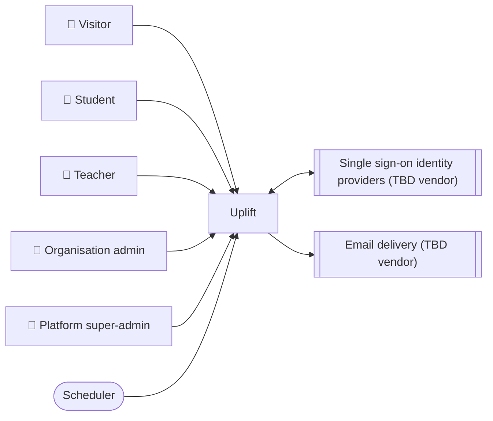

<!-- GENERATED from design/ — do not edit. Rebuild with tools/design/build.py -->
# External systems and constraints

_Generated document · design v3.4.0 · source f327e6c4cf53_

## Context diagram

### EXT-001 — Single sign-on identity providers _(deferred)_

Organisation SSO login (future) · direction: both · owner: third-party

Requirements for the choice:
- Providers not chosen yet (OAuth such as Google/Microsoft, possibly SAML)
- Per-organisation configuration
- Works through Laravel Socialite

Prepare now:
- MUST allow a user without a password (nullable password column) so SSO-only accounts are possible
- MUST resolve the organisation from the subdomain before authentication so login methods can be configured per organisation
- MUST NOT put provider-specific identity fields on the users table; external identities will live in their own table

| environment | mode | tool | config vars |
|---|---|---|---|
| development | tbd |  |  |

### EXT-002 — Email delivery _(deferred)_

Invitations, password reset, email verification and notifications · direction: outbound · owner: third-party

Requirements for the choice:
- Free tier or very low cost (SCOPE-002)
- SMTP or a Laravel mail driver
- Deliverability for transactional email (SPF/DKIM)

Prepare now:
- MUST send email only through Laravel Mail/Notifications, never a provider SDK directly
- MUST send email from queued jobs

| environment | mode | tool | config vars |
|---|---|---|---|
| development | catcher | Mailpit | MAIL_* |

## Organisational constraints

| id | constraint |
|---|---|
| ORG-001 | τα δεδομένα να μένουν σε ΕΕ (λογικό για ανηλίκους και GDPR) |

## Decisions

| id | title | status | decision |
|---|---|---|---|
| DEC-001 | Email notifications | decided | Besides account emails (invitation, password reset, verification), email is sent for: new announcement, new activity in an enrolled course space, new or final grade, topic approved or rejected, group invitation. Everything else is in-app only |
| DEC-002 | Notification centre, announcement notifications and email opt-out | decided (inferred) | Every user has a notification centre page, newest first, grouped by day, 20 per page, with read/unread per entry and 'mark all as read'; users cannot delete notifications. A bell in the app header shows the unread count, refreshed on page load (no live broadcast). In PHASE-2 the only kind is announcement_published: one in-app entry per student enrolled when it is posted (author excluded), with course space and announcement titles as they were then; its link obeys the normal access rules. Its email carries the space name, the announcement title and a link, not the body. Emails go in the user's locale, else the organisation's default_locale. Each user has one on/off switch for DEC-001 notification emails, shown in their settings; account emails cannot be turned off and in-app entries are always created |
| DEC-003 | Grade notification timing | decided | A student is notified of a quiz grade (grade_finalised, in-app entry and DEC-001 email together) when the final score becomes visible to them, not when it is graded. An attempt's result is released once it is graded (final) and its quiz's score_visibility is immediate, or after_deadline with no deadline or a deadline that has passed. Assessment records the release in ENT-QuizAttempt.result_released_at and dispatches ResultReleased(organization_id, attempt_id) exactly once: in the action that makes the attempt final when it is visible then, otherwise from a scheduled command running every minute that releases every graded, unreleased attempt that has become visible (deadline passed, visibility or deadline changed by the teacher). Visibility hidden releases nothing and sends no grade notification. A release is never revoked. Provisional scores send nothing. When a regrade changes earned_points of a released attempt, Assessment dispatches ResultChanged(organization_id, attempt_id) and the student gets a grade_changed notification (in-app and email); regrades before the release send nothing beyond the later release. Notifications listen to ResultReleased and ResultChanged, not to GradeFinalised. There are no per-student deadlines |
