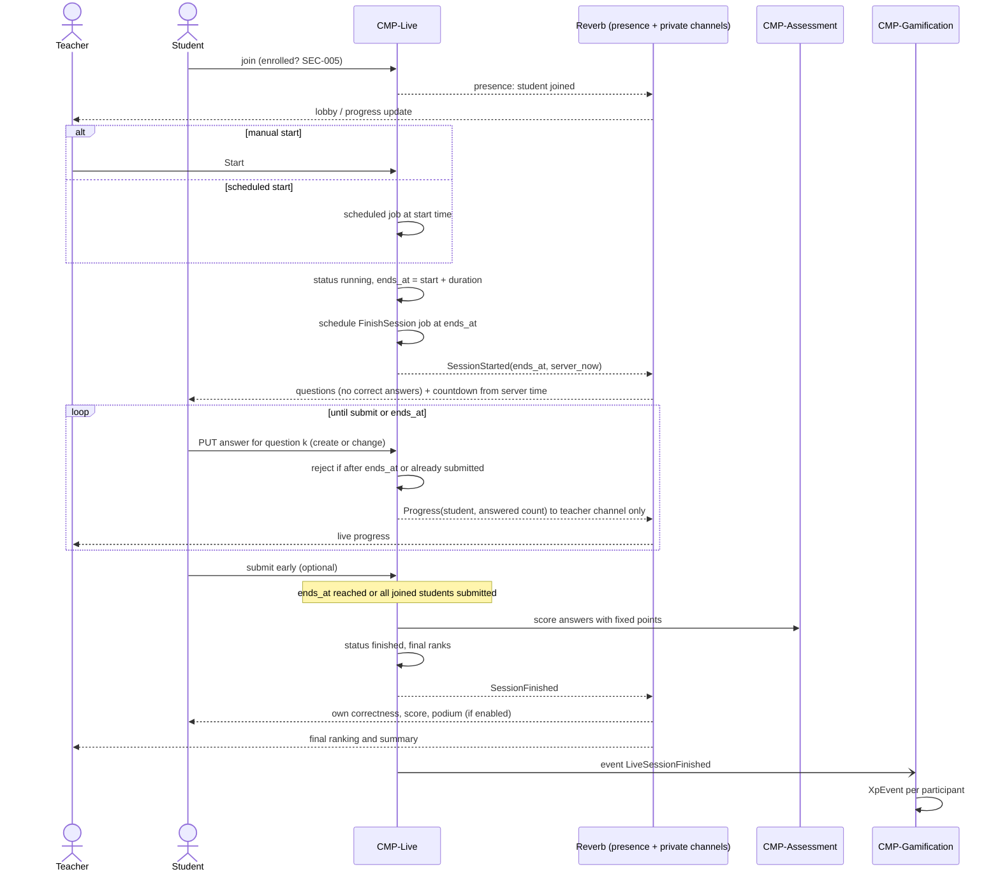
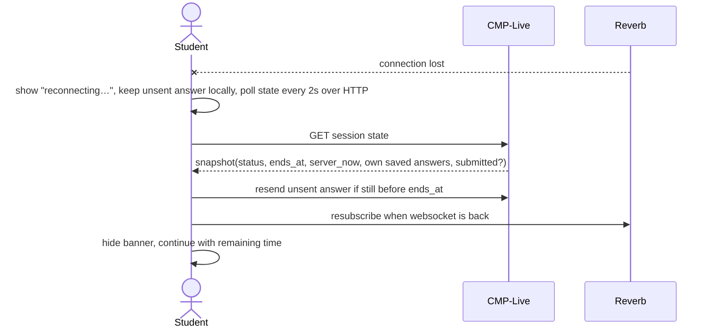
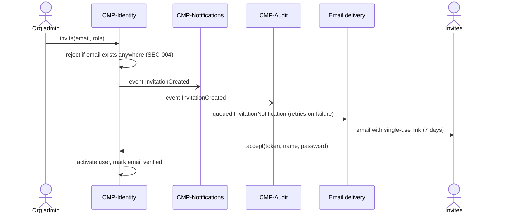

<!-- GENERATED from design/ — do not edit. Rebuild with tools/design/build.py -->
# Integrations

_Generated document · design v3.5.0 · source 174b6708ecea_

#### Laravel Mail / Notification mail channel (INT-001: CMP-Notifications ↔ EXT-002)

Mechanism: Laravel Notifications over the mail channel (Laravel Mail, SMTP or a Laravel mail driver), always queued; Identity's account emails (Fortify reset, verification, invitation) use the same queued mail channel

Operations:
- `InvitationNotification(invitation_id)`
- `ResetPasswordNotification(user_id, token)`
- `VerifyEmailNotification(user_id)`
- `AnnouncementPublished(announcement_id)`
- `ActivityPublished(activity_id)`
- `GradeFinalised(attempt_id)`
- `GradeChanged(attempt_id)`
- `TopicProposalDecided(proposal_id)`
- `GroupInvitation(group_membership_id), on GroupInvitationCreated (SCOPE-025)`

Failure policy: timeout 10s, retries 5, exponential backoff via queue (1m, 5m, 15m, 1h, 6h), idempotency key —; when unavailable: Emails stay queued and are retried; no user flow is blocked; the in-app notification is created regardless; after the last retry an invitation shows 'email not delivered' to the admin, who can resend it

#### IdentityProviderResolver (INT-002: CMP-Identity ↔ EXT-001)

Mechanism: Laravel Socialite drivers per provider, configured per organisation (deferred)

Operations:
- `providersFor(organization_id) -> list of enabled providers`
- `resolveUser(organization_id, provider, external_subject) -> User or null`

Failure policy: timeout 10s, retries 0 (interactive login), idempotency key —; when unavailable: Login with that provider shows an error; users with a password can still log in with email and password

## Flows

### FLOW-001 — Live quiz run (common time window, free navigation)

### FLOW-002 — Live quiz reconnection

### FLOW-003 — Invitation and account activation

## Decisions

_none_
