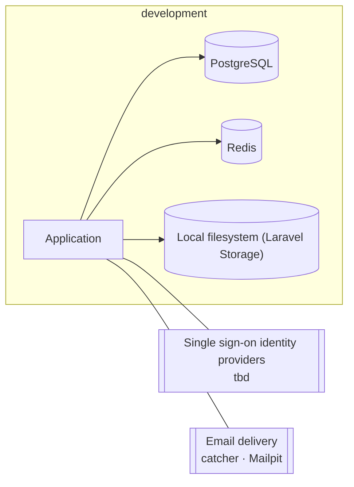

<!-- GENERATED from design/ — do not edit. Rebuild with tools/design/build.py -->
# Deployment and operations

_Generated document · design v3.4.0 · source f327e6c4cf53_

## Environment: development

## Targets

| target | value |
|---|---|
| alerts_to | Engineer's email |
| release | Deploy never while a live quiz session is running (OPS-002) |

## CI/CD stages

1. lint and format (Pint
2. ESLint
3. Prettier)
4. static analysis (Larastan)
5. unit and feature tests (Pest
6. Vitest)
7. browser tests (Pest browser)
8. architecture tests (deptrac)
9. design check (tools/design/ci_check.py)
10. dependency audit (composer audit
11. npm audit)

## Hosting — OPS-001 _(deferred)_

Not decided yet.

### Infrastructure requirements

- Data, backups and logs inside the EU (ORG-001)
- Free or very low cost (SCOPE-002)
- One server of ~2 vCPU / 4 GB RAM is enough for web, queue worker, scheduler, Reverb, PostgreSQL 18 and Redis 8 at the target scale
- Long-lived WebSocket connections allowed (rules out serverless and most shared hosting)
- Wildcard DNS (*.domain) and a wildcard TLS certificate (Let's Encrypt DNS-01 challenge, so a DNS provider with an API)
- Off-site EU storage for backups
- Meets the RPO, RTO and availability targets set by OPS-003

## Decisions

| id | title | status | decision |
|---|---|---|---|
| OPS-001 | Production hosting | deferred (inferred) | → PHASE-9 |
| OPS-002 | Deploys and live quizzes | decided (inferred) | A deploy waits until no live session is running |
| OPS-003 | Operational targets (RPO, RTO, availability, backups) | deferred | → PHASE-9 |
| OPS-004 | Repository and CI | decided | The repository lives on GitHub; CI runs on GitHub Actions (free tier). The design gate (.github/workflows/design.yml) exists from now; the application pipeline with the stages in operations.ci is created in the first phase |
