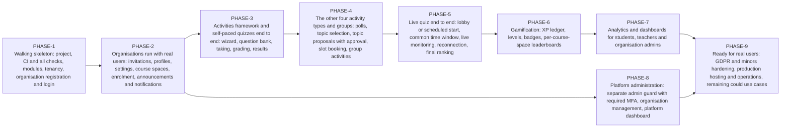
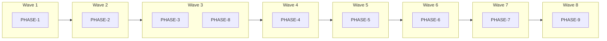
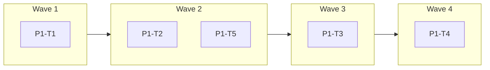
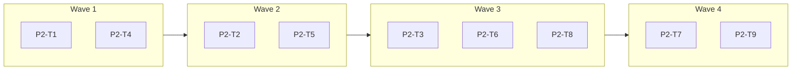
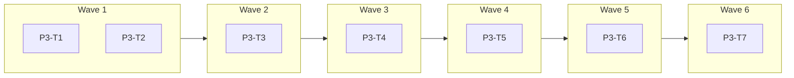
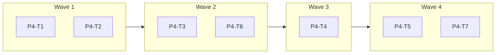
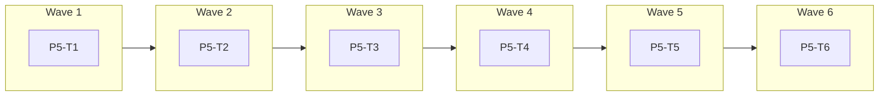
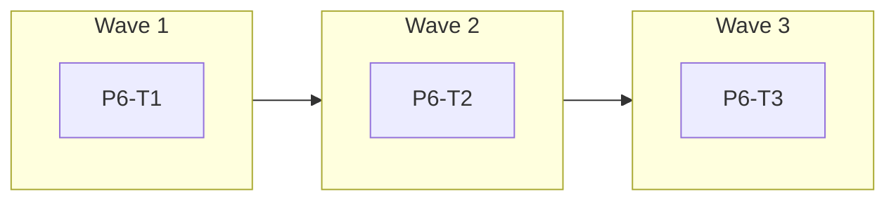
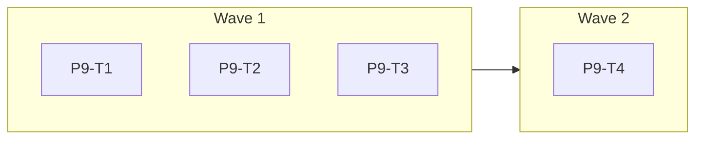

<!-- GENERATED from design/ — do not edit. Rebuild with tools/design/build.py -->
# Implementation phases

_Generated document · design v3.1.0 · source 6c4796be3fe5_

## Phase map

## Phases that can run in parallel

## Use case coverage

| use case | title | priority | phases |
|---|---|---|---|
| UC-001 | Register organisation | must | PHASE-1 |
| UC-002 | Find my organisation | could | PHASE-9 |
| UC-003 | Log in | must | PHASE-1 |
| UC-004 | Recover password and verify email | must | PHASE-1 |
| UC-005 | Accept invitation | must | PHASE-2 |
| UC-006 | Manage my profile | should | PHASE-2 |
| UC-007 | View notifications | should | PHASE-2 |
| UC-008 | Post and read announcements | should | PHASE-2 |
| UC-010 | Student dashboard | should | PHASE-7 |
| UC-011 | Browse catalogue and enrol | must | PHASE-2 |
| UC-012 | Take self-paced quiz | must | PHASE-3 |
| UC-013 | Vote in poll | must | PHASE-4 |
| UC-014 | Select assignment topic | must | PHASE-4 |
| UC-015 | Propose assignment topic | must | PHASE-4 |
| UC-016 | Book presentation or exam slot | must | PHASE-4 |
| UC-017 | View my results | must | PHASE-3 |
| UC-018 | View gamification profile | should | PHASE-6 |
| UC-019 | Manage groups | should | PHASE-4 |
| UC-020 | Teacher dashboard | should | PHASE-7 |
| UC-021 | Manage course space | must | PHASE-2 |
| UC-022 | Create activity | must | PHASE-3 |
| UC-023 | Manage question bank | should | PHASE-3 |
| UC-024 | Run live quiz | must | PHASE-5 |
| UC-025 | Play live quiz | must | PHASE-5 |
| UC-026 | Grade free-text answers | must | PHASE-3 |
| UC-027 | Approve proposed topics | must | PHASE-4 |
| UC-028 | Review submissions | must | PHASE-3 |
| UC-029 | View analytics and export CSV | must | PHASE-7 |
| UC-030 | Bulk import from CSV | should | PHASE-3 |
| UC-031 | Organisation dashboard | should | PHASE-7 |
| UC-032 | Manage users | must | PHASE-2 |
| UC-033 | Configure organisation | should | PHASE-2 |
| UC-034 | Organisation analytics | could | PHASE-7 |
| UC-035 | Platform dashboard | could | PHASE-8 |
| UC-036 | Manage organisations | should | PHASE-8 |
| UC-037 | Award XP | should | PHASE-6 |
| UC-038 | Deadline reminders | could | PHASE-9 |
| UC-039 | Export or erase my data | could | PHASE-9 |

## PHASE-1 — Walking skeleton: project, CI and all checks, modules, tenancy, organisation registration and login

Depends on: none · use cases: UC-001, UC-003, UC-004 · environment: development

| task | title | depends on | writes | migrations |
|---|---|---|---|---|
| P1-T1 | Project skeleton, tooling and CI | — | — |  |
| P1-T2 | Tenancy core | P1-T1 | CMP-Tenancy | yes |
| P1-T3 | Users and login per subdomain | P1-T2 | CMP-Identity | yes |
| P1-T4 | Organisation registration | P1-T3 | CMP-Identity |  |
| P1-T5 | Audit log | P1-T1 | CMP-Audit | yes |

Task waves:

Out of scope:
- Invitations, user management, profile (PHASE-2)
- Course spaces and activities (PHASE-2, PHASE-3)
- Platform admin and MFA for admins (PHASE-2 and PHASE-8)
- SSO (EXT-001, future)
- Production image and deploy (PHASE-9)

## PHASE-2 — Organisations run with real users: invitations, profiles, settings, course spaces, enrolment, announcements and notifications

Depends on: PHASE-1 · use cases: UC-005, UC-032, UC-006, UC-033, UC-021, UC-011, UC-008, UC-007 · environment: development

| task | title | depends on | writes | migrations |
|---|---|---|---|---|
| P2-T1 | Invitations and user management | — | CMP-Identity | yes |
| P2-T2 | Profile, nickname, language and optional MFA for org admins | P2-T1 | CMP-Identity | yes |
| P2-T3 | Organisation settings | P2-T1 | CMP-Tenancy, CMP-Identity | yes |
| P2-T4 | Course spaces and enrolment | — | CMP-Courses | yes |
| P2-T5 | Announcements | P2-T4 | CMP-Courses | yes |
| P2-T6 | Notifications in-app and by email | P2-T1, P2-T5 | CMP-Notifications | yes |
| P2-T7 | Audit entries for registration, users and settings | P2-T1, P2-T3, P2-T8 | CMP-Audit | yes |
| P2-T8 | Archived course spaces hidden and emptied | P2-T4 | CMP-Courses |  |
| P2-T9 | Invitation delivery failure and resend | P2-T1 | CMP-Identity | yes |

Task waves:

Serialised:
- P2-T3 serialised after P2-T2 (writes CMP-Identity)
- P2-T8 serialised after P2-T5 (writes CMP-Courses)
- P2-T9 serialised after P2-T2 (writes CMP-Identity)
- P2-T9 waits: max_parallel=3

Out of scope:
- Activities of any type (PHASE-3, PHASE-4)
- Groups (PHASE-4)
- Leaderboards and XP (PHASE-6)
- Dashboards beyond a placeholder home page per role (PHASE-7)
- Deadline reminders (PHASE-9)

## PHASE-3 — Activities framework and self-paced quizzes end to end: wizard, question bank, taking, grading, results

Depends on: PHASE-2 · use cases: UC-022, UC-023, UC-012, UC-026, UC-017, UC-028, UC-030 · environment: development

| task | title | depends on | writes | migrations |
|---|---|---|---|---|
| P3-T1 | Activity base, ActivityType contract and wizard shell | — | CMP-Activities | yes |
| P3-T2 | Personal question bank | — | CMP-Assessment | yes |
| P3-T3 | Quiz activity type | P3-T1, P3-T2 | CMP-Assessment | yes |
| P3-T4 | Take a self-paced quiz | P3-T3 | CMP-Assessment, CMP-Activities | yes |
| P3-T5 | Grading, results and quiz submissions | P3-T4 | CMP-Assessment |  |
| P3-T6 | CSV question import | P3-T2 | CMP-Assessment |  |
| P3-T7 | Notifications for new activities and grades | P3-T1, P3-T5 | CMP-Notifications, CMP-Assessment | yes |

Task waves:

Serialised:
- P3-T6 serialised after P3-T3 (writes CMP-Assessment)
- P3-T6 serialised after P3-T4 (writes CMP-Assessment)
- P3-T6 serialised after P3-T5 (writes CMP-Assessment)
- P3-T7 serialised after P3-T6 (writes CMP-Assessment)

Out of scope:
- Polls, topics, slots, groups and group attempts (PHASE-4)
- Live quizzes; the wizard offers only self-paced mode (PHASE-5)
- XP, badges, leaderboards (PHASE-6)
- Analytics and dashboards (PHASE-7)

## PHASE-4 — The other four activity types and groups: polls, topic selection, topic proposals with approval, slot booking, group activities

Depends on: PHASE-3 · use cases: UC-019, UC-013, UC-014, UC-015, UC-027, UC-016 · environment: development

| task | title | depends on | writes | migrations |
|---|---|---|---|---|
| P4-T1 | Groups | — | CMP-Courses | yes |
| P4-T2 | Polls | — | CMP-Activities | yes |
| P4-T3 | Topic selection | P4-T1, P4-T2 | CMP-Activities | yes |
| P4-T4 | Topic proposals and approval | P4-T3 | CMP-Activities | yes |
| P4-T5 | Slot booking | P4-T1, P4-T4 | CMP-Activities | yes |
| P4-T6 | Group quiz attempts | P4-T1 | CMP-Assessment | yes |
| P4-T7 | Notifications for topic decisions and group invitations | P4-T1, P4-T4 | CMP-Notifications |  |

Task waves:

Out of scope:
- Live quizzes (PHASE-5)
- XP and badges (PHASE-6)
- Analytics (PHASE-7)

## PHASE-5 — Live quiz end to end: lobby or scheduled start, common time window, live monitoring, reconnection, final ranking

Depends on: PHASE-4 · use cases: UC-024, UC-025 · environment: development

| task | title | depends on | writes | migrations |
|---|---|---|---|---|
| P5-T1 | Live mode in the wizard | — | CMP-Assessment |  |
| P5-T2 | Live session engine | P5-T1 | CMP-Live | yes |
| P5-T3 | Real-time channels and reconnection | P5-T2 | CMP-Live |  |
| P5-T4 | Teacher monitor UI | P5-T3 | CMP-Live |  |
| P5-T5 | Student player UI (mobile-first) | P5-T3 | CMP-Live |  |
| P5-T6 | Live quiz load browser test | P5-T4, P5-T5 | CMP-Live |  |

Task waves:

Serialised:
- P5-T5 serialised after P5-T4 (writes CMP-Live)

Out of scope:
- XP awarding (PHASE-6 listens to LiveSessionFinished)
- Per-question pacing, reveal, live leaderboard during the quiz, projector mode (SCOPE-021)

## PHASE-6 — Gamification: XP ledger, levels, badges, per-course-space leaderboards

Depends on: PHASE-5 · use cases: UC-037, UC-018 · environment: development

| task | title | depends on | writes | migrations |
|---|---|---|---|---|
| P6-T1 | XP ledger and levels | — | CMP-Gamification | yes |
| P6-T2 | Badges | P6-T1 | CMP-Gamification | yes |
| P6-T3 | Gamification profile and leaderboards | P6-T2 | CMP-Gamification |  |

Task waves:

Out of scope:
- Dashboards showing XP (PHASE-7)

## PHASE-7 — Analytics and dashboards for students, teachers and organisation admins

Depends on: PHASE-6 · use cases: UC-029, UC-010, UC-020, UC-031, UC-034 · environment: development

| task | title | depends on | writes | migrations |
|---|---|---|---|---|
| P7-T1 | Teacher analytics and CSV export | — | CMP-Analytics |  |
| P7-T2 | Student and teacher dashboards | P7-T1 | CMP-Analytics |  |
| P7-T3 | Organisation dashboard and aggregate analytics | P7-T1 | CMP-Analytics |  |

Task waves:

Serialised:
- P7-T3 serialised after P7-T2 (writes CMP-Analytics)

Out of scope:
- Platform dashboard (PHASE-8)

## PHASE-8 — Platform administration: separate admin guard with required MFA, organisation management, platform dashboard

Depends on: PHASE-2 · use cases: UC-036, UC-035 · environment: development

| task | title | depends on | writes | migrations |
|---|---|---|---|---|
| P8-T1 | Platform admin guard and MFA | — | CMP-Platform | yes |
| P8-T2 | Manage organisations and platform dashboard | P8-T1 | CMP-Platform |  |
| P8-T3 | Audit of platform admin actions | P8-T2 | CMP-Audit |  |

Task waves:

Out of scope:
- Impersonation of organisation users
- Billing (non-goal)

## PHASE-9 — Ready for real users: GDPR and minors hardening, production hosting and operations, remaining could use cases

Depends on: PHASE-7, PHASE-8 · use cases: UC-039, UC-038, UC-002 · environment: development

| task | title | depends on | writes | migrations |
|---|---|---|---|---|
| P9-T1 | GDPR export and erasure, minors' consent | — | CMP-Identity | yes |
| P9-T2 | Deadline reminders | — | CMP-Notifications |  |
| P9-T3 | Find my organisation | — | CMP-Tenancy |  |
| P9-T4 | Production image, deploy script and backups | — | — |  |

Task waves:

Serialised:
- P9-T4 waits: max_parallel=3

Out of scope:
- SSO (EXT-001, after the first production release)
