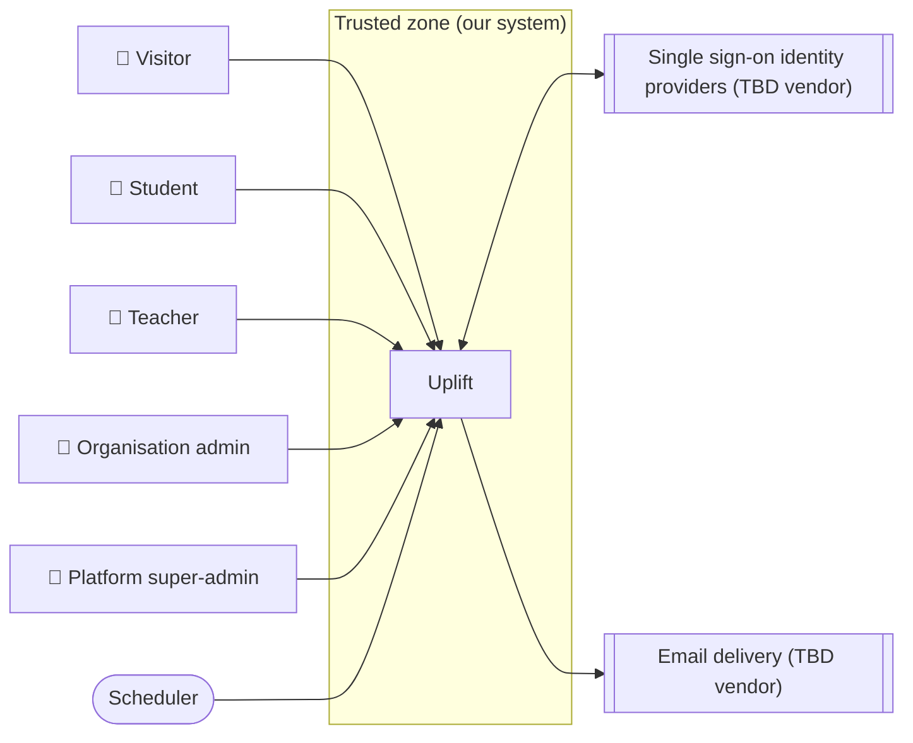

<!-- GENERATED from design/ — do not edit. Rebuild with tools/design/build.py -->
# Security and compliance

_Generated document · design v2.5.0 · source a4fd23ca974f_

## Trust boundaries

## Roles

| id | from actor | MFA |
|---|---|---|
| ROLE-Guest | ACT-Visitor | — |
| ROLE-Student | ACT-Student | none |
| ROLE-Teacher | ACT-Teacher | none |
| ROLE-OrgAdmin | ACT-OrgAdmin | optional |
| ROLE-PlatformAdmin | ACT-SuperAdmin | required |
| ROLE-System | ACT-Scheduler | — |

## Permission matrix

| use case | ROLE-Guest | ROLE-Student | ROLE-Teacher | ROLE-OrgAdmin | ROLE-PlatformAdmin | ROLE-System |
|---|---|---|---|---|---|---|
| UC-001 Register organisation | ✓ |  |  |  |  |  |
| UC-002 Find my organisation | ✓ |  |  |  |  |  |
| UC-003 Log in |  | ✓ | ✓ | ✓ |  |  |
| UC-004 Recover password and verify email |  | ✓ | ✓ | ✓ |  |  |
| UC-005 Accept invitation |  | ✓ | ✓ |  |  |  |
| UC-006 Manage my profile |  | ✓ | ✓ | ✓ |  |  |
| UC-007 View notifications |  | ✓ | ✓ | ✓ |  |  |
| UC-008 Post and read announcements |  | ✓ | ✓ |  |  |  |
| UC-010 Student dashboard |  | ✓ |  |  |  |  |
| UC-011 Browse catalogue and enrol |  | ✓ |  |  |  |  |
| UC-012 Take self-paced quiz |  | ✓ |  |  |  |  |
| UC-013 Vote in poll |  | ✓ |  |  |  |  |
| UC-014 Select assignment topic |  | ✓ |  |  |  |  |
| UC-015 Propose assignment topic |  | ✓ |  |  |  |  |
| UC-016 Book presentation or exam slot |  | ✓ |  |  |  |  |
| UC-017 View my results |  | ✓ |  |  |  |  |
| UC-018 View gamification profile |  | ✓ |  |  |  |  |
| UC-019 Manage groups |  | ✓ |  |  |  |  |
| UC-020 Teacher dashboard |  |  | ✓ |  |  |  |
| UC-021 Manage course space |  |  | ✓ | ✓ |  |  |
| UC-022 Create activity |  |  | ✓ |  |  |  |
| UC-023 Manage question bank |  |  | ✓ |  |  |  |
| UC-024 Run live quiz |  |  | ✓ |  |  |  |
| UC-025 Play live quiz |  | ✓ |  |  |  |  |
| UC-026 Grade free-text answers |  |  | ✓ |  |  |  |
| UC-027 Approve proposed topics |  |  | ✓ |  |  |  |
| UC-028 Review submissions |  |  | ✓ |  |  |  |
| UC-029 View analytics and export CSV |  |  | ✓ |  |  |  |
| UC-030 Bulk import from CSV |  |  | ✓ |  |  |  |
| UC-031 Organisation dashboard |  |  |  | ✓ |  |  |
| UC-032 Manage users |  |  |  | ✓ |  |  |
| UC-033 Configure organisation |  |  |  | ✓ |  |  |
| UC-034 Organisation analytics |  |  |  | ✓ |  |  |
| UC-035 Platform dashboard |  |  |  |  | ✓ |  |
| UC-036 Manage organisations |  |  |  |  | ✓ |  |
| UC-037 Award XP |  |  |  |  |  | ✓ |
| UC-038 Deadline reminders |  |  |  |  |  | ✓ |
| UC-039 Export or erase my data |  | ✓ | ✓ | ✓ |  |  |

## Ownership rules

| id | entity | rule | applies to |
|---|---|---|---|
| OWN-001 | ENT-User | A student or teacher reads and edits only their own user record; an org admin manages only users of their own organisation | ROLE-Student, ROLE-Teacher, ROLE-OrgAdmin |
| OWN-002 | ENT-Invitation | An org admin sees and revokes only invitations of their own organisation | ROLE-OrgAdmin |
| OWN-003 | ENT-Enrolment | A student sees only their own enrolments; a teacher sees enrolments only of course spaces they own | ROLE-Student, ROLE-Teacher |
| OWN-004 | ENT-CourseSpace | A teacher edits only course spaces they own; an org admin may view but not edit course spaces of their organisation | ROLE-Teacher, ROLE-OrgAdmin |
| OWN-005 | ENT-GroupMembership | A student sees memberships only of groups they belong to or are invited to; a teacher sees groups only of course spaces they own | ROLE-Student, ROLE-Teacher |
| OWN-006 | ENT-QuizAttempt | A student reads only their own attempts or attempts of their group; a teacher reads only attempts of quizzes in course spaces they own; an org admin never reads individual attempts, only aggregates (SEC-007) | ROLE-Student, ROLE-Teacher, ROLE-OrgAdmin |
| OWN-007 | ENT-Answer | A student reads only answers of their own or their group's attempts; a teacher grades only answers of quizzes in course spaces they own; an org admin never reads individual answers (SEC-007) | ROLE-Student, ROLE-Teacher, ROLE-OrgAdmin |
| OWN-008 | ENT-TopicChoice | A student changes only their own or their group's topic choice; a teacher sees choices only of their own activities | ROLE-Student, ROLE-Teacher |
| OWN-009 | ENT-TopicProposal | A student reads only their own or their group's proposals; a teacher decides only proposals of their own activities | ROLE-Student, ROLE-Teacher |
| OWN-010 | ENT-Booking | A student changes only their own or their group's booking; a teacher sees bookings only of their own activities | ROLE-Student, ROLE-Teacher |
| OWN-011 | ENT-PollParticipation | A student sees only their own participation; a teacher sees only vote counts per option and the number of participants, never who voted or what anyone voted | ROLE-Student, ROLE-Teacher |
| OWN-012 | ENT-LiveParticipant | A student sees only their own progress and score, plus the final ranking (nicknames only, SEC-008) when enabled; the host teacher sees all participants of their session | ROLE-Student, ROLE-Teacher |
| OWN-013 | ENT-LiveAnswer | A student sees only their own live answers; during the session the host teacher sees only how many questions each participant has answered, after it finishes the scores and answer distributions of their own session | ROLE-Student, ROLE-Teacher |
| OWN-014 | ENT-XpEvent | A student sees only their own XP events; others see only totals on leaderboards when enabled | ROLE-Student |
| OWN-015 | ENT-UserBadge | A student sees only their own badges | ROLE-Student |
| OWN-016 | ENT-Question | A teacher reads, edits and deletes only their own bank questions (in_bank = true, owner_id = self); org admins and students have no access to any question bank (DATA-008) | ROLE-Teacher, ROLE-OrgAdmin, ROLE-Student |

## Personal and sensitive data

| entity | field | class | retention |
|---|---|---|---|
| ENT-User | name | personal | While the account exists; erasure and anonymisation periods are set by SEC-003 |
| ENT-User | nickname | personal | While the account exists; erasure and anonymisation periods are set by SEC-003 |
| ENT-User | email | personal | While the account exists; erasure and anonymisation periods are set by SEC-003 |
| ENT-User | password | sensitive | While the account exists; erasure and anonymisation periods are set by SEC-003 |
| ENT-User | date_of_birth | personal | While the account exists; erasure and anonymisation periods are set by SEC-003 |
| ENT-User | is_minor | personal | While the account exists; erasure and anonymisation periods are set by SEC-003 |
| ENT-User | two_factor_secret | sensitive | While the account exists; erasure and anonymisation periods are set by SEC-003 |
| ENT-User | two_factor_recovery_codes | sensitive | While the account exists; erasure and anonymisation periods are set by SEC-003 |
| ENT-Invitation | email | personal | Deleted 30 days after it stops being pending |
| ENT-Invitation | token_hash | sensitive | Deleted 30 days after it stops being pending |
| ENT-TopicProposal | description | personal | Kept with the activity; follows the student's erasure (SEC-003) |
| ENT-QuizAttempt | earned_points | personal | Kept while the course space exists; follows the student's erasure (SEC-003) |
| ENT-Answer | text_response | personal | As ENT-QuizAttempt |
| ENT-Answer | feedback | personal | As ENT-QuizAttempt |
| ENT-LiveParticipant | score | personal | Kept with the session; follows the student's erasure (SEC-003) |
| ENT-LiveAnswer | response | personal | As ENT-LiveParticipant |
| ENT-PlatformAdmin | name | personal | While the admin account exists |
| ENT-PlatformAdmin | email | personal | While the admin account exists |
| ENT-PlatformAdmin | password | sensitive | While the admin account exists |

## Decisions

| id | title | status | decision |
|---|---|---|---|
| SEC-001 | Authentication | superseded | Email and password authentication via Laravel Breeze (Inertia + Vue preset); SSO via Socialite is deferred but the integration point is prepared. TOTP MFA is required for platform admins, optional for org admins, not offered to teachers and students |
| SEC-002 | Authorisation model | decided | User role is an enum; authorisation is enforced through Laravel Policies |
| SEC-003 | GDPR and minors' data hardening | deferred | → PHASE-9 |
| SEC-004 | User, role and organisation cardinality | decided | Each user belongs to exactly one organisation and has exactly one role |
| SEC-005 | Live quiz participation | decided | Only authenticated students enrolled in the course space can join its live quizzes; no anonymous PIN join |
| SEC-006 | Platform super-admins outside tenancy | decided | Super-admins live in a separate platform_admins table with their own guard, log in on the apex domain and are never members of an organisation |
| SEC-007 | Organisation admin oversight | decided | Org admins have high-level oversight of their own organisation: they see its course spaces, teachers and students, manage users and settings, and see aggregate analytics; they never see individual grades, answers or submissions |
| SEC-008 | Leaderboard identity | decided | Leaderboards are per course space and show only a nickname and avatar chosen by the student, never real names. A nickname is auto-generated until the student changes it, is unique within the organisation, and teachers see it next to the real name |
| SEC-009 | Poll anonymity for teachers | decided | Teachers see vote counts per option only; never who voted or what any student voted |
| SEC-010 | Security baseline | decided (default) | argon2id passwords (min 8, uncompromised check); host-only session cookie per subdomain with CSRF; private/presence Reverb channels authorised by the same Policies; rate limits; audit log; restricted uploads; security headers; dependency audits; OWASP Top 10 baseline; GDPR in scope, no PCI |
| SEC-011 | Authentication (official Vue starter kit) | decided | Authentication comes from the official Laravel Vue starter kit (Inertia + Vue + TypeScript, auth on Laravel Fortify) instead of the unmaintained Breeze. Email and password; TOTP MFA via Fortify, required for platform admins, optional for org admins, not offered to teachers and students; SSO via Socialite deferred (EXT-001) |
| SEC-012 | Optional MFA for org admins | decided (inferred) | TOTP MFA through Fortify (confirm: true, confirmPassword: true), offered only to org admins. The secret and recovery codes are stored encrypted on the user. The two-factor challenge at login is limited to 5 attempts per minute per login session. When a user stops being an org admin, their MFA is cleared in the same transaction. No admin may reset another admin's MFA in this phase |
