<!-- GENERATED from design/ — do not edit. Rebuild with tools/design/build.py -->
# Actors and use cases

_Generated document · design v2.6.0 · source 1e1896d1b977_

## Actors

| id | name | kind | authenticated | count | description |
|---|---|---|---|---|---|
| ACT-Visitor | Visitor | human | False |  | Anonymous visitor of the public site on the apex domain |
| ACT-Student | Student | human | True |  | Learner enrolled in course spaces; label is configurable per organisation (student / pupil / trainee) |
| ACT-Teacher | Teacher | human | True |  | Creates course spaces and activities, hosts live quizzes, grades, reads analytics |
| ACT-OrgAdmin | Organisation admin | human | True |  | Manages users and settings of one organisation |
| ACT-SuperAdmin | Platform super-admin | human | True |  | Operates the platform across all organisations |
| ACT-Scheduler | Scheduler | system | False |  | Runs scheduled jobs (deadlines, reminders) |

## Use case diagram

```mermaid
flowchart LR
  ACT_OrgAdmin["👤 Organisation admin"]
  ACT_Scheduler["👤 Scheduler"]
  ACT_Student["👤 Student"]
  ACT_SuperAdmin["👤 Platform super-admin"]
  ACT_Teacher["👤 Teacher"]
  ACT_Visitor["👤 Visitor"]
  subgraph SYSTEM["System"]
    UC_001(["UC-001: Register organisation"])
    UC_002(["UC-002: Find my organisation"])
    UC_003(["UC-003: Log in"])
    UC_004(["UC-004: Recover password and verify email"])
    UC_005(["UC-005: Accept invitation"])
    UC_006(["UC-006: Manage my profile"])
    UC_007(["UC-007: View notifications"])
    UC_008(["UC-008: Post and read announcements"])
    UC_010(["UC-010: Student dashboard"])
    UC_011(["UC-011: Browse catalogue and enrol"])
    UC_012(["UC-012: Take self-paced quiz"])
    UC_013(["UC-013: Vote in poll"])
    UC_014(["UC-014: Select assignment topic"])
    UC_015(["UC-015: Propose assignment topic"])
    UC_016(["UC-016: Book presentation or exam slot"])
    UC_017(["UC-017: View my results"])
    UC_018(["UC-018: View gamification profile"])
    UC_019(["UC-019: Manage groups"])
    UC_020(["UC-020: Teacher dashboard"])
    UC_021(["UC-021: Manage course space"])
    UC_022(["UC-022: Create activity"])
    UC_023(["UC-023: Manage question bank"])
    UC_024(["UC-024: Run live quiz"])
    UC_025(["UC-025: Play live quiz"])
    UC_026(["UC-026: Grade free-text answers"])
    UC_027(["UC-027: Approve proposed topics"])
    UC_028(["UC-028: Review submissions"])
    UC_029(["UC-029: View analytics and export CSV"])
    UC_030(["UC-030: Bulk import from CSV"])
    UC_031(["UC-031: Organisation dashboard"])
    UC_032(["UC-032: Manage users"])
    UC_033(["UC-033: Configure organisation"])
    UC_034(["UC-034: Organisation analytics"])
    UC_035(["UC-035: Platform dashboard"])
    UC_036(["UC-036: Manage organisations"])
    UC_037(["UC-037: Award XP"])
    UC_038(["UC-038: Deadline reminders"])
    UC_039(["UC-039: Export or erase my data"])
  end
  ACT_Visitor --- UC_001
  ACT_Visitor --- UC_002
  ACT_Student --- UC_003
  ACT_Teacher --- UC_003
  ACT_OrgAdmin --- UC_003
  ACT_Student --- UC_004
  ACT_Teacher --- UC_004
  ACT_OrgAdmin --- UC_004
  ACT_Student --- UC_005
  ACT_Teacher --- UC_005
  ACT_Student --- UC_006
  ACT_Teacher --- UC_006
  ACT_OrgAdmin --- UC_006
  ACT_Student --- UC_007
  ACT_Teacher --- UC_007
  ACT_OrgAdmin --- UC_007
  ACT_Teacher --- UC_008
  ACT_Student --- UC_008
  ACT_Student --- UC_010
  ACT_Student --- UC_011
  ACT_Student --- UC_012
  ACT_Student --- UC_013
  ACT_Student --- UC_014
  ACT_Student --- UC_015
  ACT_Student --- UC_016
  ACT_Student --- UC_017
  ACT_Student --- UC_018
  ACT_Student --- UC_019
  ACT_Teacher --- UC_020
  ACT_Teacher --- UC_021
  ACT_Teacher --- UC_022
  ACT_Teacher --- UC_023
  ACT_Teacher --- UC_024
  ACT_Student --- UC_025
  ACT_Teacher --- UC_026
  ACT_Teacher --- UC_027
  ACT_Teacher --- UC_028
  ACT_Teacher --- UC_029
  ACT_Teacher --- UC_030
  ACT_OrgAdmin --- UC_031
  ACT_OrgAdmin --- UC_032
  ACT_OrgAdmin --- UC_033
  ACT_OrgAdmin --- UC_034
  ACT_SuperAdmin --- UC_035
  ACT_SuperAdmin --- UC_036
  ACT_Scheduler --- UC_037
  ACT_Scheduler --- UC_038
  ACT_Student --- UC_039
  ACT_Teacher --- UC_039
  ACT_OrgAdmin --- UC_039
```

## Use cases

#### UC-001 — Register organisation (must)

Actors: ACT-Visitor · Goal: Create an organisation with its subdomain and first admin account (self-serve)

Main flow:
1. Visitor opens sign-up on the apex domain
2. Enters organisation name and a subdomain; availability is checked live
3. Enters admin name, email and password
4. Organisation is created as active with the initial settings of DATA-010; the admin is created with ROLE-OrgAdmin and a verification email is queued
5. Visitor is redirected to the login page of the organisation subdomain, which shows that a verification link was sent (session cookies are host-only, SEC-010)
6. Admin logs in there and sees the verify-email page until the email is verified

Exceptions:
- Subdomain taken, reserved or invalid: organisation is not created and the field shows the reason

Acceptance criteria:
- Given no organisation uses 'acme', When a visitor registers 'Acme' with subdomain 'acme', Then an active organisation with subdomain 'acme' exists and its only user has role org_admin
- Given an organisation with subdomain 'acme', When a visitor registers subdomain 'acme' or 'ACME', Then registration is rejected and no organisation or user is created
- Given the reserved subdomains www, app, api, admin, mail, When a visitor registers any of them, Then registration is rejected
- Given subdomains 'ab' (2 chars), '-acme', 'acme_1' and a 31-character name, When registered, Then each is rejected; 'acme-1' (3-30 chars, a-z, 0-9, inner hyphens) is accepted
- Given a visitor using the Greek UI, When they register 'acme', Then the organisation has student terms Μαθητής/Student, teacher terms Καθηγητής/Teacher, grading_scale scale_0_10, leaderboard_enabled true and default_locale el; with the English UI default_locale is en
- Given a successful registration of 'acme', When it completes, Then one verification email to the admin is queued and the visitor lands on acme's login page with the verification-sent notice
- Given an IP with 3 successful registrations in the last hour, When it submits a 4th valid registration, Then it is rejected with 429 and nothing is created
- Given an IP with 5 registrations rejected by validation in the last hour, When it submits a valid registration, Then the organisation is created

#### UC-002 — Find my organisation (could)

Actors: ACT-Visitor · Goal: Enter a subdomain and be redirected to the organisation's space

#### UC-003 — Log in (must)

Actors: ACT-Student, ACT-Teacher, ACT-OrgAdmin · Goal: Sign in with email and password on the organisation subdomain

Main flow:
1. User opens the login page on their organisation's subdomain (organisation logo shown)
2. Enters email and password
3. Is redirected to the dashboard of their role

Exceptions:
- Wrong credentials: generic error, no hint whether the email exists
- User belongs to another organisation: login fails exactly like wrong credentials
- User or organisation deactivated: login refused
- Too many attempts: throttled

Acceptance criteria:
- Given a teacher of 'acme', When they log in with correct credentials on acme's subdomain, Then they reach the teacher dashboard
- Given a teacher of 'acme', When they log in with correct credentials on the subdomain of 'beta', Then login fails with the same message as a wrong password
- Given a deactivated user, When they log in with correct credentials, Then login is refused
- Given 5 failed attempts for one email within 1 minute, When a 6th attempt is made in that minute, Then it is rejected without checking the password

#### UC-004 — Recover password and verify email (must)

Actors: ACT-Student, ACT-Teacher, ACT-OrgAdmin · Goal: Reset a forgotten password; verify email address

Main flow:
1. User requests a reset link with their email on the organisation subdomain
2. Receives an email with a single-use link
3. Sets a new password

Exceptions:
- Unknown email: the same confirmation message is shown and no email is sent
- Expired or used link: rejected, user may request a new one

Acceptance criteria:
- Given a reset link issued 61 minutes ago, When it is used, Then it is rejected
- Given a reset link already used once, When it is used again, Then it is rejected
- Given an email not registered in the organisation, When a reset is requested, Then the response is identical to a registered email and no email is sent
- Given a user with an unverified email, When they open any page other than verification, Then they are sent to the verification notice

#### UC-005 — Accept invitation (must)

Actors: ACT-Student, ACT-Teacher · Goal: Activate an invited account by setting a password

Main flow:
1. Invitee opens the link from the invitation email
2. Sees the organisation and assigned role, sets name and password
3. Account is activated with verified email and the invitee is logged in

Exceptions:
- Expired, revoked or already accepted invitation: rejected with a message to contact the admin

Acceptance criteria:
- Given an invitation sent 8 days ago, When it is opened, Then it is rejected as expired
- Given an accepted invitation, When the link is opened again, Then it is rejected
- Given an invitation for role teacher, When accepted, Then the user has role teacher in the inviting organisation only

#### UC-006 — Manage my profile (should)

Actors: ACT-Student, ACT-Teacher, ACT-OrgAdmin · Goal: Edit name, nickname, avatar, language and password; org admins also manage optional MFA

Main flow:
1. User opens their settings and edits name, nickname, avatar (from the preset set) and language (el, en or organisation default)
2. Changes the password by entering the current one; other sessions end
3. An org admin enables MFA by confirming the password and a first TOTP code, and may disable it

Exceptions:
- Nickname taken in the organisation (ignoring case) or invalid: not saved, the field shows the reason
- Wrong current password: password not changed
- Email, role, date of birth and minor flag are shown but not editable

Acceptance criteria:
- Given a student of 'acme', When they set nickname 'Fox_7', avatar avatar-03 and language en, Then these are saved and leaderboards and broadcasts use them
- Given a user 'Fox_7' in 'acme', When another user of 'acme' sets nickname 'fox_7', Then it is rejected; a user of 'beta' may use it
- Given nicknames 'ab', a 31-character one, 'fox 7' and 'fox@7', When saved, Then each is rejected; 'Αλεπού.7' is accepted
- Given a user, When they submit a new email, role, date_of_birth or is_minor, Then none changes
- Given a user with two sessions, When they change their password with the correct current one, Then the other session is logged out; with a wrong current one nothing changes
- Given a teacher or student, When they try to enable MFA, Then it is refused with 403
- Given an org admin with MFA, When an admin demotes them to teacher, Then their MFA columns are empty and they log in without a code
- Given an org admin with MFA, When they enter 6 wrong codes within a minute, Then the 6th attempt is throttled

#### UC-007 — View notifications (should)

Actors: ACT-Student, ACT-Teacher, ACT-OrgAdmin · Goal: See notifications grouped by day, mark read/unread, and turn notification emails off

Main flow:
1. User sees the unread count on the bell in the header and opens the notification centre
2. Notifications are listed newest first, grouped by day, 20 per page
3. Opening one marks it read and goes to its target; the user may mark entries unread or mark all as read
4. In their settings the user may turn DEC-001 notification emails off or on

Acceptance criteria:
- Given teacher A posts in space S with enrolled students X and Y, Then X and Y each get one announcement_published entry and one queued email in their locale with the space name, title and link, and A gets none
- Given the mail transport fails for X, Then X still has the in-app entry
- Given X turned notification emails off, When A posts, Then X gets the in-app entry and no email; a password reset email is still sent to X
- Given X has 3 unread notifications, When X marks all as read, Then the bell shows 0
- Given user X, When they request or mark the notifications of user Y, Then it is refused and nothing changes
- Given an announcement is deleted after posting, When X opens its notification, Then the course space opens without it; if S is archived, Then it returns 404

#### UC-008 — Post and read announcements (should)

Actors: ACT-Teacher, ACT-Student · Goal: Teacher posts announcements in a course space; students read them

Main flow:
1. Teacher opens their course space and posts an announcement with title and body; it is published at once
2. Enrolled students are notified (P2-T6) and read it in the course space, newest first
3. The teacher may edit or delete it later; an edit notifies nobody

Exceptions:
- Not the owning teacher: posting, editing and deleting are refused
- Archived space: the teacher may still post and edit, but nobody is notified and students cannot see the space (DATA-012)

Acceptance criteria:
- Given teacher A owns space S, When A posts 'Exam moved', Then it is shown to A and to every student enrolled in S, with published_at set, and AnnouncementPublished is dispatched once
- Given space S of teacher A, When teacher B, an org admin or a student tries to post, edit or delete in S, Then it is refused and nothing changes
- Given an announcement in S, When a student not enrolled in S, another teacher or an org admin requests S's announcements, Then none is shown
- Given A edits an announcement, Then title and body change, published_at is unchanged and no AnnouncementPublished is dispatched
- Given A deletes an announcement, Then it is soft-deleted and no longer shown
- Given S is archived, When A posts, Then it is stored and no AnnouncementPublished is dispatched

#### UC-010 — Student dashboard (should)

Actors: ACT-Student · Goal: See enrolled spaces, upcoming activities and deadlines, recent grades, gamification snapshot

#### UC-011 — Browse catalogue and enrol (must)

Actors: ACT-Student · Goal: Find course spaces of the organisation and enrol

Main flow:
1. Student searches and filters the catalogue of active course spaces of their organisation
2. Opens a space and enrols: directly if the policy is open, by entering the enrolment key if the policy is key
3. The space appears among the student's enrolled spaces

Exceptions:
- Wrong enrolment key: not enrolled, error shown
- Already enrolled: no duplicate enrolment
- Archived space: enrolment refused

Acceptance criteria:
- Given a space with policy open, When a student enrols, Then they are enrolled without a key
- Given a space with policy key and key 'K7P2Q', When a student enters 'K7P2Q', Then they are enrolled; When they enter 'WRONG', Then they are not enrolled
- Given a student already enrolled, When they enrol again, Then exactly 1 enrolment exists
- Given a student of 'acme', When they browse the catalogue, Then no course space of another organisation is listed

> Engineer: “Εγγραφή φοιτητή σε χώρο μαθήματος θα μπορεί να γίνει είτε ελεύθερα είτε με κωδικό εγγραφής, ο καθηγητής προσδιορίζει έναν από τους δύο τρόπους ανά χώρο μαθήματος”

#### UC-012 — Take self-paced quiz (must)

Actors: ACT-Student · Goal: Answer a timed quiz with single-choice, multiple-choice, true/false, matching and free-text questions, then submit

Main flow:
1. Student starts an attempt of a published quiz before its deadline; the timer starts
2. Answers questions of the five types; answers are saved as they go
3. Submits, or the attempt is auto-submitted when the time runs out
4. Auto-gradable questions are scored at once; free-text answers wait for teacher grading
5. Student sees their score immediately unless the teacher configured otherwise

Exceptions:
- No attempts left: a new attempt is refused
- An attempt already in progress: starting another is refused; the student continues the open one
- Teacher closes the activity: every in-progress attempt is submitted with the answers saved so far
- Time runs out: the answers given so far are submitted
- Connection lost: saved answers are kept; the timer keeps running on the server
- Quiz with free-text questions: the score is shown as provisional until graded

Acceptance criteria:
- Given a quiz allowing 2 attempts and a student with 2 submitted attempts, When they start another, Then it is refused
- Given an attempt with a 10-minute limit and 3 of 5 questions answered, When 10 minutes pass, Then the attempt is submitted with those 3 answers
- Given negative marking enabled with -0.25 per wrong answer on a 1-point question, When the answer is wrong, Then that question scores -0.25; given negative marking disabled, Then it scores 0
- Given default result visibility, When a student submits, Then they see their score immediately
- Given the timer is enforced on the server, When an answer arrives after the limit, Then it is not counted
- Given a 1-point multiple-choice question with 2 correct options of 4, When the student selects both correct and 1 wrong, Then it scores 0.50; When they select all 4, Then it scores 0
- Given a 1-point matching question with 3 pairs and 2 matched correctly, Then it scores 0.67
- Given negative marking of 25%, When a multiple-choice answer earns partial credit, Then no deduction applies; When a question is left unanswered, Then it scores 0
- Given negative marking and every answer wrong, When submitted, Then earned_points is 0
- Given a 30-minute limit and a deadline 10 minutes after the start, Then the attempt ends at the deadline
- Given a quiz with no time limit and no deadline and an attempt in progress, When the teacher closes the activity, Then the attempt is submitted
- Given a quiz without free-text questions, When submitted, Then the attempt is graded; given one with a free-text question, Then it stays submitted until that answer is graded
- Given a quiz allowing 2 attempts with 1 submitted and 1 in progress, When the student starts another, Then it is refused

> Engineer: “το α είναι όσες ορίσει ο καθηγητής, το β ναι υποβάλλεται αυτόματα ότι έχει απαντήθει, το γ θα πρέπει να υπάρχει και αρνητική βαθμολόγηση (επιλογή του καθηγητή), το δ όπως ορίσει ο καθηγητής με default να βλέπει την βαθμολογία του ο φοιτητής αμέσως μετα την υποβολή”

#### UC-013 — Vote in poll (must)

Actors: ACT-Student · Goal: Choose one or more options in an anonymous poll and see results as configured

Main flow:
1. Student opens an open poll in an enrolled course space
2. Selects one option, or up to the allowed number of options
3. Submits the vote; it cannot be changed
4. Sees results after voting or after the poll closes, as set by the teacher

Exceptions:
- Already voted: a second vote is refused
- Poll closed: voting refused

Acceptance criteria:
- Given a student who has voted, When they vote again, Then it is refused and the tally is unchanged
- Given a poll with results after closing, When a student has voted and the poll is still open, Then results are not shown to them
- Given 3 votes on option A and 1 on B, When results are shown, Then A has 3 and B has 1 and no voter identity is shown to anyone, including the teacher and org admin
- Given a poll allowing at most 2 options, When a student selects 3, Then the vote is rejected

#### UC-014 — Select assignment topic (must)

Actors: ACT-Student · Goal: Pick an available topic from the teacher's list, individually or for the group

Main flow:
1. Student opens the topic list; each topic shows remaining capacity
2. Selects a topic with free capacity (for the group in group activities)
3. May change or cancel the selection until the deadline

Exceptions:
- Topic full: selection refused
- Deadline passed: change or cancel refused

Acceptance criteria:
- Given a topic with capacity 1 and two students selecting it at the same time, Then exactly one selection succeeds
- Given a student holding topic A before the deadline, When they switch to topic B with free capacity, Then they hold B and A regains 1 free place
- Given the deadline has passed, When a student cancels their topic, Then it is refused
- Given a group activity, When one member selects a topic, Then all members see the topic as their group's selection

#### UC-015 — Propose assignment topic (must)

Actors: ACT-Student · Goal: Propose a topic title and description and follow its approval status

Main flow:
1. Student (or one member for the group) submits a title and description before the deadline
2. Proposal status is pending until the teacher decides
3. Student sees approved or rejected with the teacher's comment

Exceptions:
- Rejected: the student may submit a new proposal before the deadline
- Pending proposal exists: a second concurrent proposal is refused

Acceptance criteria:
- Given a rejected proposal and the deadline not passed, When the student proposes again, Then a new pending proposal is created
- Given a pending proposal, When the student submits another, Then it is refused
- Given an approved proposal, Then the student cannot submit another proposal for that activity

#### UC-016 — Book presentation or exam slot (must)

Actors: ACT-Student · Goal: Pick and confirm an available time slot

Main flow:
1. Student sees slots in a calendar or list with remaining capacity
2. Books a slot with free capacity (for the group in group activities)
3. May change or cancel the booking until the deadline

Exceptions:
- Slot full: booking refused
- Deadline passed: change or cancel refused

Acceptance criteria:
- Given a slot with capacity 2 holding 2 bookings, When a third student books it, Then it is refused
- Given a student with a booking, When they book another slot of the same activity, Then the first booking is released (one booking per student or group)
- Given two concurrent bookings for the last place of a slot, Then exactly one succeeds

#### UC-017 — View my results (must)

Actors: ACT-Student · Goal: See grades and teacher feedback per activity and overall

Main flow:
1. Student opens My results
2. Sees each activity's score on the organisation's grading scale, status (provisional or final) and teacher feedback
3. Opens an activity result; correct answers are shown only if the teacher allowed it

Acceptance criteria:
- Given a 0-10 scale and a score of 7 out of 8 points, Then the result shows 8.8
- Given a quiz with ungraded free-text answers, Then the result is marked provisional
- Given a student, When they request another student's result, Then it is refused

#### UC-018 — View gamification profile (should)

Actors: ACT-Student · Goal: See XP, level progress, badges and leaderboard positions

#### UC-019 — Manage groups (should)

Actors: ACT-Student · Goal: Create a group, invite members, accept or decline invitations for group activities

#### UC-020 — Teacher dashboard (should)

Actors: ACT-Teacher · Goal: See own spaces, items to grade, recent submissions and class statistics

#### UC-021 — Manage course space (must)

Actors: ACT-Teacher · Goal: Create and edit a course space and manage its enrolled students

Main flow:
1. Teacher creates a course space with title, description and enrolment policy (open or enrolment key)
2. Edits it, archives it when the course ends after confirming that all students are unenrolled (DATA-012)
3. Views enrolled students, adds or removes students

Exceptions:
- Another teacher's space: the teacher cannot edit it

Acceptance criteria:
- Given a teacher, When they create a course space, Then they are its owner and it is visible only within their organisation
- Given space S with 3 enrolled students, When its teacher archives it, Then S has no enrolments and one CourseSpaceArchived with removedEnrolments 3 is dispatched
- Given an archived space S, When a formerly enrolled student lists their spaces, browses the catalogue or opens S, Then S is absent and opening it returns 404
- Given an archived space S, When its teacher or an org admin of the organisation opens it, Then they can view it
- Given an archived space S, When its teacher restores it, Then S is active with no enrolments
- Given a space owned by teacher A, When teacher B tries to edit it or its activities, Then it is refused
- Given an org admin, When they open any course space of their organisation, Then they can view it

#### UC-022 — Create activity (must)

Actors: ACT-Teacher · Goal: Create an activity of one of the five types through a multi-step wizard with autosave, as draft or published

Main flow:
1. Teacher enters basics: title, description, course space, deadline, individual or group with group size
2. Chooses the type (quiz, poll, topic selection, topic proposal, slot booking) and its settings
3. For quizzes: adds questions of the five types (new or from the question bank), orders them by drag and drop, sets time limit, attempts, negative marking, pass mark and result visibility
4. Reviews and saves as draft or publishes; progress is autosaved between steps

Exceptions:
- Invalid step: cannot publish until every required field is valid
- Quiz with any attempt, including one in progress: settings that change grading (questions, options, pairs, points, correct answers, negative marking) cannot be edited (SCOPE-023)

Acceptance criteria:
- Given a quiz with no questions, When the teacher publishes it, Then publishing is refused
- Given a live quiz, When the teacher adds a free-text question, Then it is refused
- Given a draft activity, Then no student can see it
- Given a teacher who leaves the wizard at step 3, When they return, Then the steps they completed are restored
- Given a published quiz with 1 submission, When the teacher changes a question's correct answer, Then it is refused
- Given a published quiz with 1 in-progress attempt and no submission, When the teacher removes a question or option, Then it is refused
- Given a new quiz in the wizard, Then it has 1 attempt, score visible immediately, answers visible after the deadline, no time limit, no negative marking and no pass mark
- Given a time limit of 0 or 1441 minutes or max_attempts of 0 or 101, When saved, Then it is refused

#### UC-023 — Manage question bank (should)

Actors: ACT-Teacher · Goal: Create and edit reusable questions of the five question types

Main flow:
1. Teacher opens their question bank (newest first)
2. Creates a question: chooses the type, writes the prompt, sets the points and adds options or matching pairs, ordering them by drag and drop
3. Saves; the question is validated per DATA-016 and kept in the bank
4. Later edits or deletes it; quiz copies are unaffected

Exceptions:
- Question breaks a DATA-016 rule: nothing is saved and the field shows the reason
- Another teacher, an org admin or a student opens a bank question or the bank pages: refused (OWN-016)

Acceptance criteria:
- Given a single-choice question with 2 correct options, When saved, Then it is refused
- Given a multiple-choice question with no correct option, When saved, Then it is refused
- Given a choice question with 1 or 11 options, When saved, Then it is refused
- Given a matching question with 1 pair or a pair with an empty side, When saved, Then it is refused
- Given a free-text question with options, When saved, Then it is refused
- Given points of 0, 100.01 or 1.005, When saved, Then it is refused
- Given a true/false question, When a teacher with the English UI and one with the Greek UI view it, Then they see 'True'/'False' and 'Σωστό'/'Λάθος' respectively, and the stored texts are 'true' and 'false'
- Given a choice question, When the teacher reorders its options by drag and drop and saves, Then the new order is kept
- Given teacher A's bank question, When teacher B opens, edits or deletes it, Then it is refused and nothing changes
- Given a teacher's bank question, When they delete it, Then it is gone from the bank

#### UC-024 — Run live quiz (must)

Actors: ACT-Teacher · Goal: Run a quiz that all enrolled students take at the same time within one common time window, monitor progress live and show the final ranking

Main flow:
1. Teacher prepares the quiz like any other activity and chooses the start mode: manual (lobby, teacher presses Start) or scheduled (starts automatically at a set date and time)
2. Manual mode: the lobby shows enrolled students as they join; the teacher presses Start
3. At start the common end time is fixed: start time + quiz duration
4. While running, the teacher sees live progress: who joined, how many questions each student has answered, who has submitted
5. At the common end time (or when every joined student has submitted) the quiz finishes, answers are scored and the final ranking with podium is shown to teacher and students

Exceptions:
- Manual mode, teacher closes the lobby without starting: the quiz is not considered run and can be started later
- Teacher disconnects: the quiz continues and finishes at the common end time
- Leaderboards disabled for the organisation: no podium or ranking is shown; each student sees only their own score
- Quiz already run: it cannot be started again (SCOPE-019)

Acceptance criteria:
- Given a manual-start live quiz with 15 minutes duration started at 10:00:00, Then its end time is 10:15:00 for every student
- Given a scheduled live quiz at 10:00, When the clock reaches 10:00, Then it starts without teacher action
- Given 50 joined students, When a student answers a question, Then the teacher's progress view reflects it within 1 second
- Given a running quiz, When the teacher closes their browser, Then the quiz still finishes at its end time and is scored
- Given a finished live quiz, When the teacher tries to start it again, Then it is refused
- Given a running quiz with 30 joined students, When the 30th submits before the end time, Then the quiz finishes immediately
- Given a lobby closed without starting, When the teacher opens a new lobby for the same quiz, Then it is allowed
- Given a 3-point multiple-choice question with 3 correct options and a student who selected 2 of them, Then they earn 2 points
- Given leaderboards are disabled for the organisation, Then neither teacher nor students see a ranking or podium

> Engineer: “όταν έλεγα live quiz εννοούσα μία δραστηριότητα quiz που διεξάγεται σε πραγματικό χρόνο, ο καθηγητής προετοιμάζει την δραστηριότητα (όπως θα έκανε για οποιαδήποτε άλλη) και όταν το quiz ξεκινήσει διεξάγεται σε πραγματικό χρόνο, με όλους τους μαθητές να απαντάνε live στις όποιες ερωτήσεις το quiz (αυτοί πηγαίνουν μπρος και πισω στις ερωτήσεις δεν τους καθοδηγεί ο καθηγητής).”

#### UC-025 — Play live quiz (must)

Actors: ACT-Student · Goal: Take a live quiz together with the class within the common time window, moving freely between questions, and see results and ranking at the end

Main flow:
1. Student, logged in and enrolled in the course space, opens the live quiz and waits until it starts
2. Moves freely between questions and answers or changes answers; every change is saved
3. Submits early, or the quiz is submitted automatically at the common end time
4. When the quiz finishes, sees which answers were correct, own score, final ranking with podium (if enabled) and XP earned

Exceptions:
- Not enrolled: join refused (SEC-005)
- Joins late: has only the time left until the common end time
- Connection lost: saved answers are kept; on reconnection the student continues with the remaining time
- After submitting: answers can no longer be changed

Acceptance criteria:
- Given a student not enrolled in the course space, When they try to join, Then it is refused
- Given a quiz ending at 10:15:00, When a student joins at 10:10:00, Then they have 5 minutes
- Given a student who answered question 2 with B, When they go back and change it to C before submitting, Then C is the scored answer
- Given a student who submitted early, When they try to change an answer, Then it is refused
- Given a running quiz, Then the student does not see whether any answer is correct until the quiz finishes
- Given an answer arriving after the common end time, Then it is not counted
- Given a finished live quiz, Then the student gains XP and no grade is added to My results

> Engineer: “Ναι ο φοιτητής έχει το δικαίωμα στον διαθέσιμο χρόνο να πλοηγείται στις ερωτήσεις και να διορθώνει τις απαντήσεις του αν θέλει.”

#### UC-026 — Grade free-text answers (must)

Actors: ACT-Teacher · Goal: Grade deferred free-text answers with a score and feedback

Main flow:
1. Teacher opens the answers waiting for grading, per activity
2. Enters points (0 to the question's maximum) and optional feedback
3. When all free-text answers of an attempt are graded, its score becomes final and the student is notified

Acceptance criteria:
- Given a 5-point free-text question, When the teacher enters 6, Then it is rejected
- Given an attempt with 2 free-text answers and 1 graded, Then the attempt remains provisional; When the 2nd is graded, Then it becomes final
- Given a teacher, When they grade an answer of another teacher's activity, Then it is refused

#### UC-027 — Approve proposed topics (must)

Actors: ACT-Teacher · Goal: Approve or reject student-proposed assignment topics

Main flow:
1. Teacher opens pending proposals of an activity
2. Approves, or rejects with a comment
3. The student or group is notified

Acceptance criteria:
- Given a pending proposal, When the teacher rejects it without a comment, Then it is refused
- Given a pending proposal, When approved, Then its status is approved and the student is notified

#### UC-028 — Review submissions (must)

Actors: ACT-Teacher · Goal: List submissions per activity with status and jump to grading

Main flow:
1. Teacher opens an activity's submissions: student or group, time, status, score
2. Filters by status (submitted, needs grading, graded) and opens one to grade

Acceptance criteria:
- Given an activity with 3 submissions of which 1 needs grading, When filtered by needs grading, Then exactly 1 is listed
- Given a teacher, When they open submissions of another teacher's activity, Then it is refused

#### UC-029 — View analytics and export CSV (must)

Actors: ACT-Teacher · Goal: Analyse results per activity, student, course space and over time; export CSV

Main flow:
1. Teacher opens analytics for one of their course spaces
2. Sees per activity: score distribution, average, pass rate and questions ordered by percentage of correct answers
3. Sees per student and over time across the space's activities
4. Filters by period and activity and exports the shown data as CSV

Acceptance criteria:
- Given question Q1 answered correctly by 8 of 10 and Q2 by 2 of 10, Then Q2 is listed as harder than Q1 with 20% correct
- Given a pass mark of 50% and scores 40%, 50%, 90%, Then the pass rate is 66.7%
- Given a CSV export, Then it contains exactly the rows matching the current filters
- Given a teacher, When they open analytics of another teacher's course space, Then it is refused

#### UC-030 — Bulk import from CSV (should)

Actors: ACT-Teacher · Goal: Upload a CSV of questions into the question bank, review a per-row validation report, confirm the import

Main flow:
1. Teacher opens the import page of their question bank and may download the template CSV
2. Uploads a CSV file in the DATA-017 format
3. Sees the report: every row with its line number and 'valid' or its errors
4. Confirms; the valid rows become bank questions in file order and the invalid ones are skipped
5. Sees the imported and skipped counts; the uploaded file is deleted

Exceptions:
- File not UTF-8, wrong headers, over 500 data rows or over 1 MB: the whole file is refused with the reason
- No valid row: confirm is disabled
- Teacher cancels: nothing is imported and the file is deleted
- Another user confirms or cancels the import: refused

Acceptance criteria:
- Given a valid file with one row of each of the five types, When confirmed, Then five bank questions owned by the teacher exist with the given options, correct flags, pairs and points
- Given a ';'-delimited file with points '2,5' and a UTF-8 BOM, When uploaded, Then the rows are valid and points are 2.50
- Given a file with 3 valid rows and 1 row breaking a DATA-016 rule, When uploaded, Then the report shows the invalid row's line number and error, and When confirmed, Then 3 are imported and 1 skipped
- Given a file where every row is invalid, When the report is shown, Then confirm is disabled and a confirm request imports nothing
- Given a Windows-1253 file, When uploaded, Then the whole file is refused with the save-as-CSV-UTF-8 message
- Given a file with a missing or an unknown header, When uploaded, Then the whole file is refused
- Given a file with 501 data rows, When uploaded, Then the whole file is refused
- Given teacher A's pending import, When teacher B or a teacher of another organisation confirms or cancels it, Then it is refused and nothing changes
- Given a pending import, When it is confirmed or cancelled, Then its file is deleted; Given a leftover file older than 24 hours, When the daily command runs, Then it is deleted
- Given a file changed so a row turns invalid between report and confirm, When confirmed, Then the row is re-validated and skipped
- Given the import page, When the template is downloaded, Then it has the header and one valid example row per type

> Engineer: “για την μαζική εισαγωγή προς το παρόν μόνο ερωτήσεις”

#### UC-031 — Organisation dashboard (should)

Actors: ACT-OrgAdmin · Goal: Overview of users, activity and usage

#### UC-032 — Manage users (must)

Actors: ACT-OrgAdmin · Goal: Invite users with a role, change roles, deactivate users

Main flow:
1. Admin opens the user list (search, filter by role and status, paginated)
2. Invites a user by email with a role; an invitation email is sent
3. Changes a user's role or deactivates/reactivates a user

Exceptions:
- Email already used by any user of the platform: invitation rejected (SEC-004: one organisation per user)
- Admin tries to deactivate or demote the last active org admin: rejected

Acceptance criteria:
- Given an email already registered in another organisation, When an admin invites it, Then the invitation is rejected
- Given an organisation with exactly 1 active org admin, When that admin deactivates or demotes themselves, Then it is rejected
- Given a deactivated user with an open session, When they make their next request, Then they are logged out
- Given an admin of 'acme', When they request the user list, Then no user of another organisation appears

#### UC-033 — Configure organisation (should)

Actors: ACT-OrgAdmin · Goal: Set logo, accent colour, terminology, grading scale, leaderboard on/off and default language

Main flow:
1. Org admin opens the organisation settings
2. Uploads or removes the logo, sets or clears the accent colour, edits the student and teacher terms in Greek and English, and chooses grading scale, leaderboard on/off and default language
3. Saves; the settings apply at once to every page of the organisation (DATA-011)

Exceptions:
- Accent colour not #RRGGBB, or logo not an allowed file (SEC-010): nothing is saved and the field shows the reason
- The subdomain is shown but cannot be changed

Acceptance criteria:
- Given an org admin of 'acme', When they set accent colour #1A2B3C and leaderboard off, Then acme's settings are saved and the shared prop organization shows them
- Given a teacher or student of 'acme', When they try to view or update acme's settings, Then the request is refused with 403
- Given an org admin of 'beta', When they try to update acme's settings, Then the request is refused and acme is unchanged
- Given an org admin, When they submit accent colour 'blue' or '#12345', Then nothing is saved; an empty accent colour is accepted
- Given acme has a logo, When the org admin removes it, Then the login page and app shell show the app logo
- Given acme's default language is el, When a guest or a user without a locale opens acme's login page, Then it is shown in Greek
- Given an org admin changes accent colour and leaderboard, When the save commits, Then one OrganizationSettingsChanged is dispatched with both fields as {from, to}
- Given an org admin submits a different subdomain, When saved, Then the subdomain is unchanged

#### UC-034 — Organisation analytics (could)

Actors: ACT-OrgAdmin · Goal: See aggregate figures for the organisation

#### UC-035 — Platform dashboard (could)

Actors: ACT-SuperAdmin · Goal: See all organisations and key platform metrics

#### UC-036 — Manage organisations (should)

Actors: ACT-SuperAdmin · Goal: List organisations, see status, suspend or reactivate

#### UC-037 — Award XP (should)

Actors: ACT-Scheduler · Goal: Award points, levels and badges from completed activities and live quizzes

#### UC-038 — Deadline reminders (could)

Actors: ACT-Scheduler · Goal: Notify students before an activity deadline

#### UC-039 — Export or erase my data (could)

Actors: ACT-Student, ACT-Teacher, ACT-OrgAdmin · Goal: Exercise GDPR rights of access and erasure; becomes must when SEC-003 is activated
